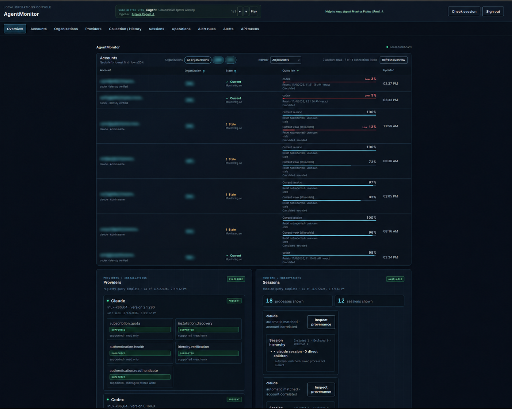

# AgentMonitor

Monitor AI account capacity and API spending in one local dashboard. AgentMonitor
shows Claude and Codex subscription quotas, Ollama cloud balances, and supported
Anthropic, OpenAI and Ollama API usage reports without interrupting running agents.

## Dashboard

Account emails and organization names are blurred in this point-in-time example.

## What you can monitor

- Organize accounts by company and provider; see the lowest remaining quotas first.
- Inspect account activity, subscription history and alerts. Unresolved process
  ownership is shown explicitly.
- View reported API spend, reporting scope, currency, coverage and freshness.
- Explore exact history, daily charts and provider-supported breakdowns.
- See observed spending rates and, when the required inputs exist, an exhaustion
  estimate. Missing balances or insufficient history have explicit explanations.
- Manage connections through the dashboard. Provider credentials are entered
  locally through the protected setup flow.

API billing access is separate from a Claude or ChatGPT subscription. Reported
costs are not invoices, and providers do not always expose remaining funds.
Missing data is not treated as zero spend or unlimited capacity.

## Source and operation

- [Backend](backend/): versioned API, domain modules, provider adapters and tests.
- [Frontend](frontend/): dashboard and product-family promotion.
- [Contracts](contracts/): published API schemas.
- [Documentation](docs/README.md): operation and architecture.
- [Release notes](RELEASE_NOTES.md): delivered changes and known limitations.

This is source code for a locally operated application, not a packaged installer.
See the [operations runbook](docs/operations/runbook.md) before installing or
upgrading. Never commit credentials, provider profiles or live databases.

## Licence

AgentMonitor is **free for personal, non-commercial use** under the
[AgentMonitor Personal Use License 1.0](LICENSE). Organizational, professional
and commercial use requires a separate written licence from
[Essential AI Solutions Ltd (EAIS)](https://essentialai.uk/).

Public source access does not grant a commercial licence. Third-party components
retain their own licences.

Copyright (c) 2026 Essential AI Solutions Ltd <support@essentialai.uk>.
