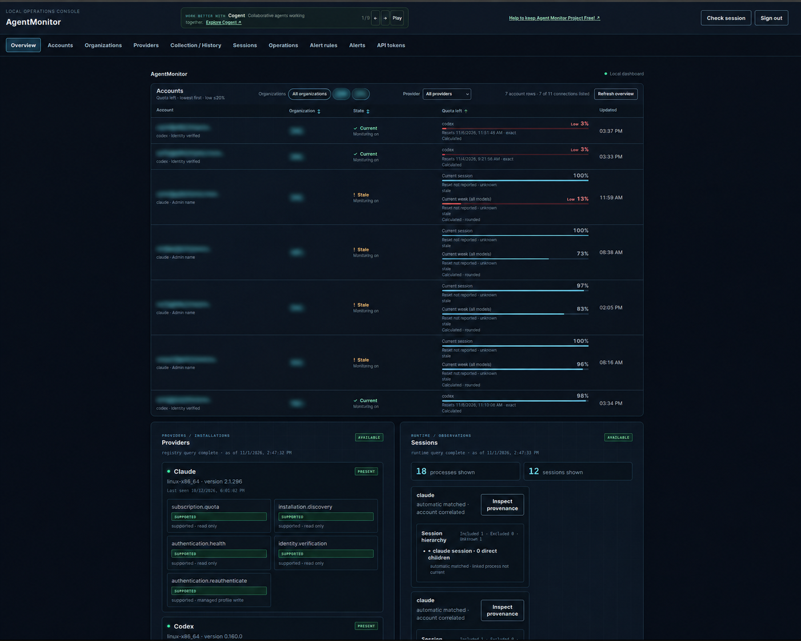

# AgentMonitor

AgentMonitor is a local-first dashboard for monitoring AI agent accounts,
subscription capacity, quota history, alerts and representative running
processes. It uses an authenticated, versioned API and is designed to observe
running agents without interrupting them.

## Dashboard demo

The screenshot is a point-in-time example of the dashboard, with account emails
and organization names blurred for privacy.

## Project status

Claude monitoring and the bounded Codex milestone have been implemented and
accepted. Ollama cloud monitoring is implemented and deployed locally, including
organization/account administration, balances, history and scheduled recovery.
M6 remains in progress: the second organization's official usage comparison,
Claude continuity verification, the full completion check and owner acceptance
are still outstanding. Local Ollama models and processes are deferred to future
versions. See the [latest delivery checkpoint](docs/evidence/m6-publication-checkpoint-2026-11-08.md).
Observations that cannot be verified are shown as unknown or unavailable.

This repository contains the current project source, including work in
progress. It is not yet a packaged V1 release. A verified one-command
installation is not yet available; see the [roadmap](docs/roadmap.md),
[implementation status](docs/evidence/v1-implementation-status-v1.json) and
[operations runbook](docs/operations/runbook.md) for current capabilities and
limitations. Do not commit credentials or provider profiles.

## Repository

- [Backend](backend/) — API, provider adapters, domain modules and tests.
- [Frontend](frontend/) — dashboard and product-family promotion.
- [Contracts](contracts/) — versioned API specifications.
- [Documentation](docs/README.md) — architecture, requirements and runbooks.
- [Tools](tools/) — development and verification commands.

The frontend uses Node.js 22.23.3 and npm 10.9.9; the Python project requires
Python 3.12.3 or later. See [CONTRIBUTING.md](CONTRIBUTING.md) and
[AGENTS.md](AGENTS.md) for the development process.

## License

AgentMonitor is **free for personal, non-commercial use** under the
[AgentMonitor Personal Use License 1.0](LICENSE). Organizational, professional
and commercial use requires a separate written licence from
[Essential AI Solutions Ltd (EAIS)](https://essentialai.uk/).

This is a source-available project. Public source access does not grant a
commercial licence. Third-party components retain their own licences.

Copyright (c) 2026 Essential AI Solutions Ltd <support@essentialai.uk>.
