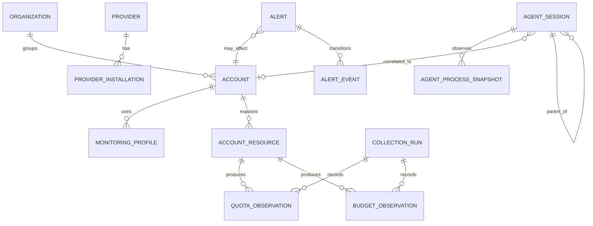

# Data model

## Modeling principles

- Store immutable observations separately from current-state projections.
- Preserve provider detail without polluting normalized invariants.
- Missing, unknown, unsupported, stale, and zero are different states.
- Store provenance with the value, not in a disconnected log.
- One module owns each table and migration.
- Store operational metadata only; never persist provider secrets or agent content.
- Use UTC internally and exact representations for money/ratios.

## Conceptual relationships

## Registry-owned records

### Organization

- internal ID;
- name and optional description;
- display order;
- lifecycle status;
- created/updated timestamps.

### Provider and provider installation

- stable provider key and display name;
- adapter/protocol version;
- installed executable/path identity and version;
- platform and discovery status;
- verified compatibility range;
- capability manifest hash/version.

### Account

- internal ID;
- provider key;
- provider-stable account ID when safely available;
- friendly name;
- organization ID or ungrouped;
- masked provider display identity when approved;
- lifecycle and monitoring enabled state;
- owner-confirmed identity timestamp.

### Monitoring profile

- internal ID and account ID;
- purpose: subscription, API, local session, or combined;
- opaque credential/profile reference;
- `protected_default_profile` flag;
- provider workspace/project references;
- last identity verification result;
- never credential contents.

### Account resource

Represents an independently constrained or billed resource: subscription plan, API organization, API project, prepaid balance, team workspace, or provider-specific pool.

## Collection-control records

### Schedule and lease

- provider/account/capability key;
- normal and current interval;
- next due time;
- backoff state/reason;
- lease owner/expiry;
- last successful and attempted run IDs.

### Collection run

- run/correlation ID;
- trigger: schedule, event, manual, re-auth verification;
- provider/account/capability;
- start/end/duration;
- outcome status;
- sanitized error code and warnings;
- source and versions;
- retry/backoff decision;
- no raw response body.

## Capacity-owned records

### Quota definition/window

- resource/account/provider;
- provider window key and safe label;
- scope/model/features when relevant;
- limit and unit when exposed;
- window start/end/reset and time precision;
- current status.

### Quota observation

- immutable observation ID;
- used, remaining, limit, percentage when supported;
- each value's unit and nullability;
- observed/collected/stored timestamps;
- provenance and input hash;
- safe versioned provider extension;
- source collection run.

### Budget/cost observation

- resource/account/project/model/key identifier where supported;
- billing interval;
- exact spend, remaining, limit, credits, and currency;
- token/request counts by provider category;
- hard/soft limit and enforcement status;
- provenance and timestamps.

### Current capacity and forecast projections

- latest valid observation references;
- freshness/staleness;
- normalized health and constraining window;
- burn rate and forecast with method/version, inputs, uncertainty, and generated time.

Derived projections are reproducible; they never overwrite observations.

## Runtime-observation records

### Agent session

- internal ID and provider session ID when safe;
- provider/installation;
- account correlation plus evidence/confidence;
- parent session ID;
- working-directory/project label;
- observable model/task label;
- start/end/last-activity times;
- normalized and raw-safe state;
- state evidence and provenance;
- no prompt/response/tool/source content.

### Process snapshot

- session ID, PID, parent PID, executable identity;
- observed time, process start time, CPU, memory, status;
- working directory when permitted;
- platform-adapter version;
- no process environment or arbitrary command-output contents.

### Runtime metric observation

- safe token/context/request counts where locally available;
- unit, scope, time, source, provider/parser versions;
- no tokenized content.

## Alerting-owned records

### Alert rule

- rule ID/type;
- scope level and scope ID;
- threshold/configuration;
- enabled state and version.

### Alert

- stable fingerprint and affected subjects;
- rule/version;
- severity and current state;
- opened/last-seen/recovered timestamps;
- occurrence count;
- source observation/event IDs;
- acknowledgement/snooze metadata.

### Alert event

Immutable state transitions: opened, repeated, escalated, acknowledged, snoozed, unsnoozed, recovered, reopened, closed by configuration.

## Identity-access records

- administrator identity and password hash parameters/material;
- browser-session ID/hash, issued/expiry/revocation, CSRF binding;
- API-token name, prefix/fingerprint, hash, scopes, issued/last-used/expiry/revocation;
- security audit events;
- no plaintext password, session token, or API token.

## Operations records

- application/schema/component versions;
- backup catalog with path reference, checksum, database integrity result, created/expiry times;
- retention-run results;
- export/diagnostic job records and artifact expiry;
- service health summaries.

## Provenance value object

Every metric-like record embeds or references:

- source class and stable source label;
- adapter/parser/provider versions;
- authoritative/reported/derived/heuristic/unknown kind;
- exact/rounded/range/estimated/unknown precision;
- confidence category and explanation code;
- freshness deadline;
- experimental flag;
- derivation method/input IDs when applicable.

## Retention

- Operational history: 365 days.
- Current projections: retained while their subject exists, rebuilt from observations where possible.
- Security audit and backup-catalog retention receive explicit module-plan limits; default one year unless a threat review requires longer.
- Backups: seven daily, four weekly, twelve monthly.
- Expiry uses a pure cutoff calculation plus a real database deletion transaction.
- Deletion is batched, auditable, and does not remove active alerts or registry identity accidentally.

## Privacy and safe extensions

Provider-specific data uses allowlisted, schema-validated extension objects. Raw provider payload storage is prohibited by default. Adding a field requires a privacy classification and proof it cannot contain prompts, responses, source, credentials, cookies, or unrelated personal information.

## Indexing and query design

Each module plan defines indexes from real query shapes. Expected keys include subject plus observed time, current-status filters, organization/provider/account filters, collection outcome plus time, alert state/severity, and session parent/state. Unbounded scans and unpaginated history endpoints are prohibited.
