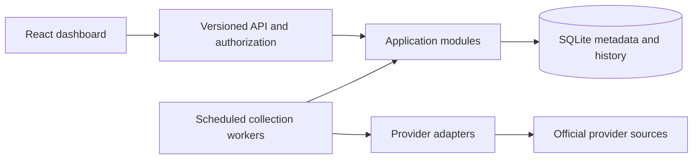

# Architecture

AgentMonitor is a local modular application with a React dashboard, a versioned
FastAPI boundary, application/domain modules, provider and operating-system
adapters, and SQLite persistence. The dashboard reads the API; it does not read
provider files or the database directly.

## Boundaries

- Identity/access authenticates dashboard sessions and API requests.
- Registry owns accounts, organizations, connections, billing resources and
  their current authority. Labels do not establish provider identity.
- Collection control owns scheduling, bounded admission, retries, deadlines and
  collection outcomes. Browser refresh is separate from provider collection.
- Capacity owns normalized quantities, monetary reports, compatible totals,
  history and qualified calculations.
- Runtime observation correlates process/session metadata with accounts only
  when supported evidence exists. Unknown links remain explicit.
- Persistence adapters implement storage, migrations, retention and recovery.
  Provider details remain in provider adapters, outside pure domain code.

The public Python contracts live in
[`backend/src/agentmonitor/contracts`](../../backend/src/agentmonitor/contracts/).
The HTTP schema is
[`contracts/openapi/agentmonitor-v1.json`](../../contracts/openapi/agentmonitor-v1.json).
The frontend client is generated from that schema. Machine-readable ownership
and contract manifests are retained under `docs/plans/` because the source
boundary checker consumes them; these are executable architecture inputs.
They retain contract IDs, module permissions and path ownership. Private plan
paths, approval history and planning commentary are excluded.

## Financial observations

Reports retain account/resource identity, provider scope, binding generation,
source, period, currency, coverage and provenance. An unknown provider scope is
not filled in from a dashboard organization label. Monetary arithmetic uses
exact values; usage quantities are not assigned locally guessed prices.

Known shared billing pools count once in compatible aggregates. Different
currencies, cost bases or periods are not silently combined. History is pinned
to a particular report, so chart pagination and navigation do not change its
meaning. Daily rates and exhaustion estimates expose their qualifying inputs
or a missing-input reason.

## Collection and failure behavior

Workers respect provider admission and persisted retry eligibility. Connection
changes fence in-flight work. A failed or uncertain attempt does not turn an old
report into a fresh successful observation. Retained history and the latest
collection outcome remain separate.

Scheduled collection continues after the browser closes. Verification uses
real providers, HTTP, storage and browsers; constructed examples are restricted
to pure calculations without I/O. Recovery verification isolates only owned
test workers and checks subsequent normal collection.

See [Security](security.md) for credential and process boundaries, and the
[operator guide](../operations/runbook.md) for dashboard workflows.
