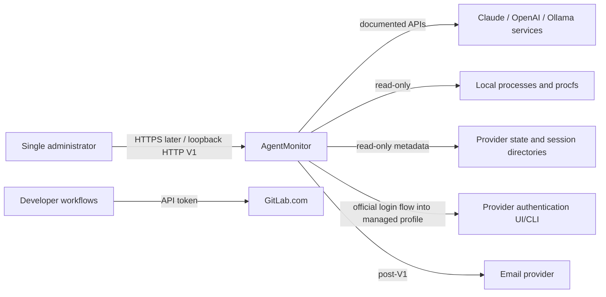
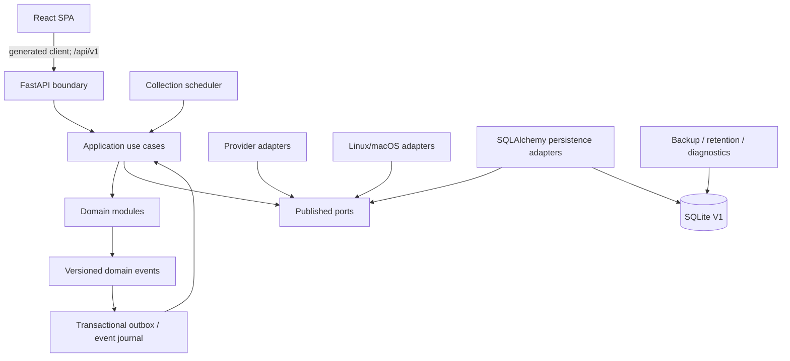

# System architecture

## Architectural style

AgentMonitor V1 is a local-first modular monolith. It is one native deployable with explicit internal bounded contexts, ports, adapters, typed events, and enforceable dependency rules. A module boundary is treated like a future service boundary even though modules share a process and physical database.

This choice avoids network, deployment, and consistency complexity while preserving independent planning, ownership, testing, and future extraction.

## Context



AgentMonitor does not sit in the request path between an agent and its provider in V1. It observes independently, so an AgentMonitor failure cannot prevent agents from working.

## Logical containers



These are logical containers, not necessarily separate operating-system processes. V1 uses one user-level service and one built frontend. The scheduler and collectors run under supervised tasks with timeouts and failure isolation. Contracts permit later worker-process separation.

## Dependency rule

Dependencies point inward:

```text
composition root
    -> API / scheduler / adapters
        -> application use cases and ports
            -> domain and published contracts
```

The domain has no knowledge of FastAPI, Pydantic transport models, SQLAlchemy, SQLite, provider SDKs, subprocesses, filesystems, HTTP clients, React, or operating systems.

## Runtime flow

### Collection

1. The collection scheduler selects due capabilities using persisted schedule and backoff state.
2. The collection-control module leases a job so duplicate service instances cannot collect it concurrently.
3. A provider or OS adapter receives an opaque account/profile reference and a deadline.
4. The adapter calls a documented provider interface or reads an approved local source.
5. The adapter validates and returns a versioned observation contract without secrets or content.
6. The owning domain module validates invariants, persists observations, and emits events through the outbox.
7. Alerting consumes events idempotently and updates alert lifecycle.
8. API queries return current projections and history with provenance.

### Manual refresh

1. Authenticated UI sends an idempotent refresh request.
2. API enqueues or joins an existing job and returns its run ID.
3. UI polls the run or receives low-frequency SSE progress.
4. A refresh never blocks an HTTP worker on a provider call.

### Re-authentication

1. User requests re-authentication for a registered AgentMonitor-managed profile.
2. The provider adapter returns an official, user-visible flow definition.
3. User completes browser/device/CLI interaction directly; secrets never traverse dashboard fields.
4. AgentMonitor verifies returned identity matches the intended account.
5. On success it records an authentication event; account identity/history remain unchanged.
6. Default provider profiles are never targeted.

## Consistency model

- Configuration and identity mutations are strongly consistent within a database transaction.
- Observations are immutable append-only facts; current state is a projection of the latest valid fact.
- Provider data is eventually consistent and always includes observation/freshness timestamps.
- Cross-module events are delivered at least once from a transactional outbox; consumers must be idempotent.
- Duplicate provider observations use deterministic idempotency keys or source identifiers when available.
- No distributed transaction is introduced in V1.

## Failure isolation

- Every provider/capability collection has a deadline, cancellation path, and bounded output.
- A malformed provider payload becomes a sanitized collection failure, not a process crash.
- Circuit/backoff state is per provider account and capability.
- One adapter cannot write another module's tables.
- API health distinguishes service alive, database ready, and individual collectors degraded.
- Last known data remains visible as stale; it is never relabeled current.
- Background task failures are supervised and surfaced as alerts/diagnostics.

## Performance envelope

Design target without architectural change:

- at least 100 registered accounts;
- at least 200 simultaneously discovered processes;
- at least five million retained observations in SQLite, subject to Milestone 0 sizing validation;
- interactive current-state queries at workstation latency;
- history queries paginated and aggregated as needed.

The current expected load—12 subscription accounts and up to 25 main agent processes—is well below this target.

## Technology boundaries

- Backend: Python, FastAPI, Pydantic, SQLAlchemy, Alembic.
- Frontend: React, TypeScript, Vite, TanStack Query, Apache ECharts, accessible primitive components.
- API: OpenAPI 3.x; `/api/v1`; Swagger UI and ReDoc.
- Persistence: SQLite V1, PostgreSQL-compatible repository contracts.
- Native service: user-level `systemd` on Linux; macOS adapter planned for `launchd`.
- CI: GitLab.com hosted runners for deterministic and local-stack suites; interactive live-provider tests on the development machine.

Exact dependency versions are chosen in a module plan, pinned in lockfiles, and admitted through the dependency policy.
