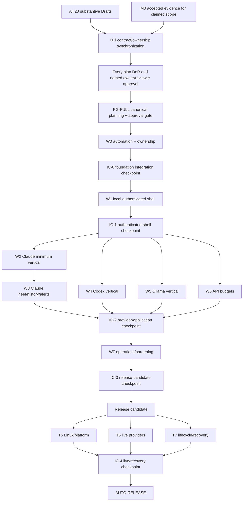

# Integration plan: PLAN-INT — V1 integration and release

- Status: **Draft — contract synchronization and approval pending; implementation and release are not authorized**
- Plan ID: `PLAN-INT`
- Plan version: `0.1.0`
- Proposed integration contract bundle: `integration-release.v1`
- Contract-register baseline: `0.2.0` Draft-aligned; owner approval, synchronization, implementation authorization, and live verification remain absent
- Primary owner: integration/release steward (unassigned)
- Required reviewers: owner; architecture/contract; PLAN-FND; M01–M08; A01–A03; A04 Linux/macOS; P01; P02; PLAN-DB; PLAN-DEP; security/privacy; test-integrity; accessibility; dependency/license; operations/recovery; GitLab/release reviewers
- Primary acceptance criteria: AC-V1-001..008
- Coordinated acceptance criteria: AC-LIVE-001..007, AC-UI-001..006, AC-PROC-001..005, AC-ALERT-001..003, AC-HIST-001..002, AC-OPS-001..006, AC-TEST-001..006
- Coordinated requirements: every Approved V1 functional requirement and every V1 non-functional requirement; Deferred requirements remain out of scope
- Primary risks: R-001..024, with particular integration ownership for R-005, R-009, R-010, R-011, R-013, R-018, R-019, R-020, and R-023
- Dependencies: all nineteen other planning workstreams in `planning-catalog.toml`; approved M0 evidence; synchronized contracts; admitted dependencies; verified canonical automation; real target environments; owner-controlled live verification
- Target milestones: one full-plan synchronization/owner-approval gate before any implementation, implementation checkpoints IC-0 through IC-4, implementation waves W0–W7, and the V1 release candidate
- Approved by/date: pending
- Implementation/release authority: none

This plan is governed by the [product requirements](../../product/requirements.md), [V1 acceptance criteria](../../product/v1-acceptance-criteria.md), [SDLC](../../engineering/sdlc.md), [completion and automation gates](../../engineering/completion-and-automation-gates.md), [testing strategy](../../engineering/testing-strategy.md), [module boundaries](../../architecture/modules.md), [contracts and versioning](../../architecture/contracts-and-versioning.md), [data model](../../architecture/data-model.md), [security architecture](../../architecture/security.md), [deployment architecture](../../architecture/deployment.md), [API standards](../../api/api-standards.md), [live-verification runbook](../../operations/live-verification-runbook.md), [planning catalog](../planning-catalog.toml), [contract register](../contract-register.md), and machine-readable [Draft-aligned contract baseline](../contract-baseline.toml).

All command interfaces, paths, contract versions, release identifiers, performance thresholds, and evidence locations in this Draft are proposals until their owning plans synchronize them. Nothing in this plan represents implemented behavior, a passed test, a live observation, a Git/GitLab action, a deployment, or a release.

## 0. Authority, evidence state, and completion rule

PLAN-INT is a planning and later orchestration boundary. It does not grant authority to:

- implement production or test code;
- install or select dependencies;
- initialize Git, create a GitLab project, push, tag, publish, or modify repository settings;
- create or edit `.env`, access credentials, enroll accounts, inspect provider files/processes, or run provider commands;
- deploy, migrate, back up, restore, stop/start a service, or alter an owner workstation;
- perform login, logout, re-authentication, quota exhaustion, token rotation, or other external state change;
- mark a Failed, Blocked, Not Run, Skipped, Unsupported, or Unknown gate Passed.

At planning time:

- all integration scenarios enumerated in section 9 are `Not Run`;
- no release candidate, release manifest, SBOM, notice bundle, evidence manifest, signed artifact, Git history, GitLab pipeline, deployment, or rollback artifact exists;
- M0 live evidence has not been accepted by an integration gate;
- all contract versions are proposals until producer/consumer synchronization and owner approval;
- PLAN-DEP may still be under independent drafting and must be re-reviewed before this plan can enter contract review;
- the synchronized planning gate cannot pass while a catalog artifact or synchronization record is absent;
- V1 release readiness is red until every mandatory acceptance criterion is individually Passed at its required real boundary.

The only valid completion claim for this plan is produced by the implemented and verified `AUTO-RELEASE` routine against an exact release candidate. Narrative review, a hosted pipeline, a partial vertical slice, a module handoff, a planning gate, or a release checklist cannot substitute for it.

## 1. Outcome and boundaries

### 1.1 Outcome

PLAN-INT delivers a reproducible, inspectable V1 release decision across independently developed modules. It ensures that:

1. every approved requirement and mandatory acceptance criterion resolves to an approved owner, versioned contract, implementation evidence, test evidence, and current documentation;
2. independent modules compose only through synchronized contracts and one approved composition root;
3. Claude, Codex, Ollama, and API-budget vertical slices cross the real provider/platform, collection, persistence, API, generated-client, browser, alerting, history, and operations boundaries without invented telemetry;
4. database, API, generated-client, application, frontend, adapter, and native-service versions form one compatible release candidate;
5. hosted deterministic evidence and owner-controlled local/provider evidence remain visibly separate;
6. every routine gate is executable, fail closed, records its actual boundary, and preserves Failed/Blocked/Not Run states;
7. release artifacts are reproducible, traceable, secret-free, license-reviewed, recoverable, and accompanied by truthful limitations.

### 1.2 In scope

- The complete planning catalog and final cross-plan synchronization review.
- Final producer/consumer contract synchronization and compatibility baselines.
- Integration composition, shared-file scheduling, and implementation-wave start/finish gates.
- Release-wide traceability and evidence aggregation without rewriting producer evidence.
- Cross-module real-stack, browser, platform, provider, lifecycle, failure-isolation, and recovery verification.
- Vertical-slice orchestration for Claude, Codex, Ollama, Anthropic API, OpenAI API, and supported Ollama API capabilities.
- OpenAPI/client, schema/migration, build, service, dependency/license, SBOM/notices, security/privacy, accessibility, performance, backup/restore, and documentation release gates.
- Git/GitLab preflight and release workflow design; execution requires separate authority.
- V1 version selection, release-candidate identity, release manifest, artifact inventory, notes, known limitations, rollback, and post-release verification.
- Canonical automation orchestration for all routines named in the mandatory automation standard.

### 1.3 Out of scope

- Owning or changing M01–M08 business rules, provider behavior, platform behavior, route semantics, UI semantics, persistence internals, or deployment mechanisms.
- Direct database queries used to bypass module query/validation ports.
- Provider data collection, profile mutation, login, or re-authentication implementation.
- Process control, terminal input, agent routing, credential switching, checkpoint/recovery, or any FR-ROUTE capability.
- Email, messenger, native desktop notification, remote hosting, multi-user IAM, transcript/content storage, or additional providers.
- Inventing telemetry, provider failure states, provider identities, compatibility claims, or release evidence.
- Creating a fake provider, test-only provider, recorded response, seeded telemetry set, demo account, or placeholder dashboard.
- Declaring macOS support from Linux evidence or blocking Linux V1 solely because macOS verification remains honestly Blocked, subject to final owner interpretation of NFR-PLAT-001.
- Publishing a release, changing GitLab, or distributing artifacts without explicit owner authorization.

### 1.4 Ownership

PLAN-INT owns the integration/release policy and future implementation of:

- the machine-readable release-gate graph and release-candidate manifest;
- the acceptance/evidence index and cross-module traceability validator;
- contract-baseline and consumer-sign-off aggregation;
- release-wide compatibility and artifact manifests;
- the `AUTO-RELEASE` orchestration behavior;
- integration test orchestration and cross-module failure-isolation scenarios;
- release notes, known-limitations report, release evidence summary, and rollback matrix;
- shared-file allocation records and serial merge/rebase order;
- final release decision records and version assignment.

It owns no application database table, business aggregate, public REST resource, provider profile, credential, provider parser, UI feature, or native service driver.

### 1.5 Proposed paths and edit ownership

The following future paths are proposed for exclusive integration/release ownership. Exact topology is synchronized with PLAN-FND before implementation:

```text
tooling/automation/integration/**
tooling/automation/release/**
backend/tests/integration/release/**
frontend/tests/browser/release/**
docs/releases/**
```

`docs/plans/integration/**` remains under the root planning shared writer. The
PLAN-INT implementation lane may propose changes there but cannot write it
concurrently or claim it as a nonshared implementation root.

The already mandated planning validator remains under `tools/planning/**` until
the synchronized Foundation topology explicitly preserves or migrates it. A
migration must keep the canonical
`python3 tools/planning/validate_plans.py --stage synchronized` entry point
working for its declared compatibility window; creating a second divergent
planning validator is prohibited.

The integration steward is the single edit allocator, but not necessarily the semantic owner, for these shared artifacts:

| Shared artifact | Semantic producer | Sole writer during a wave | Consumer rule |
|---|---|---|---|
| `docs/plans/contract-register.md` | each contract producer | integration steward | consumers submit reviewed deltas; no direct parallel edits |
| `docs/traceability.md` | each requirement owner | integration steward | module handoff supplies exact evidence rows |
| `docs/risk-register.md` | each risk owner | integration steward | Critical risk disposition requires named evidence/acceptance |
| planning registry/catalog/synchronization review | planning owners | integration steward | catalog validator is authoritative |
| composition root/adapter registration | owning modules/adapters | allocated composition steward | feature agents never self-register by editing shared files |
| migration chain/catalog | table-owning module semantics | PLAN-DB migration steward | revisions serialize in the approved linear allocation |
| CTR-EVT registry, dispatcher composition, and event-storage port registration | PLAN-INT governance, PLAN-DB mechanics, module-owned rows | integration-assigned event infrastructure steward | CTR-EVT-TOPOLOGY-001 only; feature lanes submit ports and never create a central table or self-register |
| OpenAPI artifact | P01 API semantics and route/schema source | integration steward | FND supplies the admitted deterministic generator; artifact is generated only from the running production application |
| generated TypeScript client | P01 source OpenAPI plus FND generator mechanism | integration steward | P02 owns only its wrapper and never generates or hand-edits the client |
| package manifests/lockfiles | dependency owners | foundation/dependency steward | changes enter only with admission records |
| `.gitlab-ci.yml` and CI includes | command owners | integration/CI steward; FND supplies verified commands | jobs invoke canonical routines, never duplicate them |
| build/version metadata | FND sources plus release version | release steward | modules contribute version descriptors through contracts |
| native service/package artifacts | PLAN-DEP | deployment steward | integration consumes verified digests only |
| SBOM and third-party notices | dependency graph | build/release steward | generated and checked; no manual silent omissions |

Any shared artifact without an allocated sole writer remains locked. A module needing a change submits a contract/shared-file proposal and stops its dependent increment.

CS-1 must freeze these repository-layout rules before any parallel scaffolding:

- domain persistence implementations use
  `backend/src/agentmonitor/adapters/persistence/<module>/sqlite/**`; a module
  may own the repository-port meaning, but neither it nor PLAN-DB may introduce
  the shorter `adapters/persistence/<module>/**` alternative;
- public Python contract families use one file convention,
  `backend/src/agentmonitor/contracts/<family>_v<major>.py`, including
  `runtime_observation_v1.py`; package-per-version variants are prohibited for
  V1 unless an approved breaking layout ADR replaces this rule everywhere; and
- provider-extension contracts use only
  `backend/src/agentmonitor/contracts/providers/<provider>/<capability>/v1/**`.
  The adapter owns its extension schema, M03 governs compatibility and
  registration, and core domain modules must not import the provider namespace.

These paths are synchronization proposals in this Draft, not permission to
create files. Any producer-plan disagreement blocks PG-FULL until every affected
plan, the ownership manifest, and CTR-FND-001 adopt one identical rule.

### 1.6 Allowed and forbidden dependencies

Allowed:

- public/versioned contracts from every approved producer;
- repository-owned automation entry points and structured gate results;
- signed or hashed build/migration/deployment/evidence manifests;
- module handoffs and sanitized evidence references;
- production composition factories approved by PLAN-FND.

Forbidden:

- imports from module internals, ORM entities, adapter internals, API router internals, or UI feature internals;
- SQL/table inspection except PLAN-DB's approved schema/integrity reports;
- direct provider/API/process/filesystem/service actions outside their approved adapters/routines;
- parsing raw provider output or test evidence in release code;
- swallowing a non-Passed result in an aggregate status;
- runtime dependency on GitLab, the internet, or an external telemetry service for local application correctness;
- release-only production branches or hidden bypass settings.

## 2. Requirements and acceptance traceability

### 2.1 Primary AC-V1 ownership

| Acceptance | PLAN-INT responsibility | Required producer evidence | Integration scenarios | Release gate |
|---|---|---|---|---|
| AC-V1-001 | prove every approved requirement maps to current implementation, tests, docs, versions, and evidence | all plans and traceability rows | INT-TRACE-001..006 | no missing/orphan/stale row |
| AC-V1-002 | prove all twenty plans are substantive, approved, synchronized, and have contracts/boundaries/tests/operations | planning catalog, CS-1, plan approval records | INT-PLAN-001..006 | synchronized planning validator plus approval audit |
| AC-V1-003 | bind running API source, canonical OpenAPI, compatibility diff, generated client, UI compile, and real HTTP/browser evidence | P01/P02/FND | INT-API-001..008 | exact hashes and compatibility status agree |
| AC-V1-004 | exercise fresh and every supported upgrade chain plus safe recovery | PLAN-DB/M08/DEP/module consistency ports | INT-MIG-001..008 | all supported paths Passed; unsafe downgrade named Unsupported |
| AC-V1-005 | aggregate security, privacy, threat, dependency/license, secret, and supply-chain reviews | all modules plus independent reviewers | INT-SEC-001..012, INT-LIC-001..007 | no unresolved release-blocking finding |
| AC-V1-006 | validate current user/developer/contributor/install/operate/backup/restore/diagnostic/upgrade docs against real commands | documentation owners | INT-DOC-001..008 | AUTO-DOCS-CHECK and runbook exercises Passed |
| AC-V1-007 | scan source, history where available, build/test/evidence/log/diagnostic/export/backup artifacts for real secrets | security/M08/FND/DEP | INT-SEC-003..010 | zero confirmed secret/content finding |
| AC-V1-008 | prove no production view or test claims simulated provider/account/telemetry values as real | every producer, P01/P02, test steward | INT-TEST-001..008 | prohibited-substitute and provenance gates Passed |

### 2.2 Approved functional-requirement coordination

| Exact requirement allocation | One primary evidence owner | Supporting owners | Integration responsibility and exact scenarios |
|---|---|---|---|
| FR-ORG-001..003 | PLAN-M02 | M05/M06/M07, P01/P02, DB, INT | organization lifecycle and exact global/group aggregation; INT-CLA-003, INT-CDX-003, INT-OLL-003, INT-BUD-008 |
| FR-ACC-001..006 | PLAN-M02 | M0, M03, A01–A03, M04–M06, P01/P02, DB, INT | intended-account enrollment, stable history, resource distinctions, auto-discovery, and no guessed association; INT-CLA-001, INT-CDX-001, INT-OLL-001, INT-PROC-003 |
| FR-AUTH-001 | PLAN-M03 | M02/M04/M07, A01–A03, P01/P02, INT | canonical provider-auth health through INT-LIVE-004 and INT-LIVE-007 |
| FR-AUTH-002..005 | PLAN-M02 | M03/M04, A01–A03, M01, P01/P02, security, INT | official managed-profile workflows, continuity, prohibited-secret and protected-default proof; INT-LIVE-006, INT-LIVE-009, INT-LIVE-010, and INT-SEC-006 |
| FR-AUTH-006 | PLAN-M0-DISCOVERY | M02/M03/M04, A01–A03, P01/P02, INT | real isolated-profile evidence; INT-LIVE-006 stays Blocked until accepted M0 evidence and owner authority |
| FR-QUOTA-001..005 | PLAN-M05 | M03/M04/M07, A01–A03, P01/P02, DB, INT | native windows/units/provenance/health/forecast and authoritative reconciliation; INT-CLA-003, INT-CDX-003, INT-OLL-003, INT-BUD-010 |
| FR-QUOTA-006 | PLAN-M0-DISCOVERY | M03–M05, A01–A03, P01/P02, INT | supported capability decision before provider slice credit; INT-LIVE-004 and INT-LIVE-005 |
| FR-BUDGET-001..005 | PLAN-M05 | M02–M04, A01 Anthropic, A02 OpenAI, A03 Ollama API, P01/P02, DB, INT | exact budget/resource/dimension/money behavior; INT-BUD-001..012 |
| FR-BUDGET-006 | PLAN-M0-DISCOVERY | M03–M05, A01–A03, P01/P02, INT | role/capability evidence; ownership is fixed while capability may be Unsupported; INT-BUD-001, INT-BUD-003, and INT-BUD-005 |
| FR-DISC-001..008 | PLAN-M06 | M0/M02/M03, A01–A04, P01/P02, security, INT | real process/session trees, safe field proof, versioned parsers and unresolved identity; INT-PROC-001..010 |
| FR-STATE-001..004 | PLAN-M06 | A01–A03, M07, P01/P02, DB, INT | evidence-classified states, ten-minute possible-stall and wait exclusions; INT-PROC-005..010 |
| FR-COL-001..008 | PLAN-M04 | M0/M02/M03/M05–M08, A01–A03, P01/P02, DB, INT | scheduler/backoff/idempotency/source priority/failure isolation/provenance; INT-COL-001..010 |
| FR-HIST-001 | PLAN-M08 | M01/M04–M07, DB, P01/P02, INT | 365-day coordinated retention; INT-HIST-005 |
| FR-HIST-002 | PLAN-M05 | M06/M07, P01/P02, INT | trends/reset/exhaustion timelines; INT-HIST-001 and INT-HIST-007 |
| FR-HIST-003..004 | PLAN-M08 | M05–M07, DB, P01/P02, INT | auditable purge and export-before-delete; INT-HIST-002, INT-HIST-003, INT-HIST-005, and INT-HIST-006 |
| FR-HIST-005 | PLAN-INT | M01/M02/M04–M08, DB, P01/P02 | UTC contract and configured-timezone rendering; INT-HIST-004 and INT-HIST-008 |
| FR-ALERT-001..006 | PLAN-M07 | M02–M06, A01–A03, DB, P01/P02, security, INT | threshold precedence and dashboard-only lifecycle from real inputs; INT-ALERT-001..009 |
| FR-UI-001..007 | PLAN-P02 | every data producer, P01/DEP/FND, INT | built-browser truth, density, responsiveness, accessibility, explanation and no placeholders; INT-UI-001..012 |
| FR-IAM-001..007 | PLAN-M01 | P01/P02, DB/DEP/M08/FND, security, INT | authenticated local shell, memory-hard password, sessions/CSRF/scoped tokens/Swagger/loopback; INT-IAM-001..010 |
| FR-OPS-001 | PLAN-DEP | FND/A04-LINUX/M04/M08/DB/P01/P02, INT | native user service and browser-independent lifecycle; INT-OPS-001, INT-OPS-002, and INT-OPS-010 |
| FR-OPS-002..006 | PLAN-M08 | every health/data owner, DB/DEP/P01/P02, INT | health, verified backup/restore, secret exclusions and visible versions; INT-OPS-004..014 |
| FR-SAFE-001..002 | PLAN-P01 | every module/adapter, P02/DEP/INT | exact positive allowed-action inventory and negative no-control/routing proof; INT-SAFE-001..008 |

Deferred FR-ALERT-007/008, FR-ROUTE-001/002, FR-CONTENT-001, FR-REMOTE-001, and FR-PROVIDER-EXT-001 do not enter a V1 release artifact except as explicit non-capabilities. Their presence in source, API, UI, configuration, or permissions without a new approved plan/ADR blocks release.

### 2.3 Non-functional coordination

| Requirement | One primary evidence owner | Supporting owners and integration proof |
|---|---|---|
| NFR-ARCH-001/002 | PLAN-FND | every plan supports; import/ownership graph, contract baseline, no circular/private/table bypass |
| NFR-API-001/002 | PLAN-P01 | FND/P02 and domain producers support; real OpenAPI generation/diff/client compile/browser use |
| NFR-DATA-001 | PLAN-DB | table-owning modules/M08/DEP support; real SQLite/migration/recovery and portability review |
| NFR-TEST-001/002 | PLAN-FND | every plan supports; R/G/R ledger, real-boundary selectors and prohibited-substitute scan |
| NFR-SEC-001 | PLAN-INT | every boundary/security reviewer supports; INT-SEC-001..012 and release finding closure |
| NFR-PRIV-001/002 | PLAN-INT | runtime/providers/API/UI/operations/dependency owners support; allowlist/artifact/network proof |
| NFR-DOC-001 | PLAN-FND | every owner/INT supports; linked/versioned docs plus verified-command validation |
| NFR-LIC-001 | PLAN-INT | FND/dependency owners support; actual lock graph, SBOM, notices, admission and vulnerability results |
| NFR-PLAT-001 | PLAN-A04-MAC | A04-LINUX/DEP/FND/DB/M06/INT support; real Linux evidence and macOS remains Blocked until a real Mac passes |
| NFR-PERF-001 | PLAN-INT | M02–M08/A01–A04/P01/P02/DB/DEP support; exactly 100 registered accounts and 200 simultaneous real processes |
| NFR-RES-001 | PLAN-INT | M03–M08/adapters/P01/P02/DB/DEP support; real owned-component/provider failure isolation |
| NFR-OBS-001 | PLAN-FND | all plans/M08/INT support; bounded structured log/correlation and leak scans |
| NFR-COMP-001 | PLAN-INT | every contract owner supports; compatibility reports, migrations and consumer sign-offs |

### 2.4 Acceptance-family coordination

| Exact acceptance allocation | One primary evidence owner | Supporting owners and PLAN-INT release rule |
|---|---|---|
| AC-V1-001..008 | PLAN-INT | all other plans; each criterion remains individually statused and requires section 2.1 evidence |
| AC-LIVE-001 | PLAN-A01 | M0/M02–M05/P01/P02/INT; six Claude accounts enrolled or owner-declared unavailable |
| AC-LIVE-002 | PLAN-A02 | M0/M02–M05/P01/P02/INT; four Codex accounts enrolled or owner-declared unavailable |
| AC-LIVE-003 | PLAN-A03 | M0/M02–M05/P01/P02/INT; two Ollama identities/relationships documented |
| AC-LIVE-004 | PLAN-M03 | M0/M02/M04–M06/A01–A03/INT; current live conformance matrices |
| AC-LIVE-005 | PLAN-M05 | M03/M04/A01–A03/P01/P02/INT; authoritative reconciliation |
| AC-LIVE-006 | PLAN-M02 | M03/M04/A01–A03/P01/P02/INT; owner-run reauth with preserved history/default safety |
| AC-LIVE-007 | PLAN-M03 | M04/M05/M07/A01–A03/P02/INT; natural rare states or explicit Blocked |
| AC-UI-001..006 | PLAN-P02 | M01/P01/data producers/DB/DEP/INT; T3/T4 against built candidate and real state |
| AC-PROC-001..005 | PLAN-M06 | M0/M02/M07/A01–A04/P01/P02/INT; real target workstation/provider trees |
| AC-ALERT-001..003 | PLAN-M07 | M02–M06/A01–A03/DB/P01/P02/INT; pure plus real DB/API/browser/live evidence |
| AC-HIST-001..002 | PLAN-INT | M01/M04–M08/A01–A03/DB/P01/P02; real observation path and deletion without clock manipulation |
| AC-OPS-001..002 | PLAN-DEP | FND/M04/M08/A04-LINUX/DB/P01/P02/INT; installed service and browser-independent collection |
| AC-OPS-003 | PLAN-INT | M03–M08/adapters/P01/P02/DEP; real failure isolation |
| AC-OPS-004 | PLAN-M08 | DB/DEP/P01/P02/INT; real backup rotation/restore/post-start |
| AC-OPS-005 | PLAN-DEP | DB/M01/M04–M08/INT; exercised upgrade/failure recovery |
| AC-OPS-006 | PLAN-M04 | M0/M03/A01–A03/INT; measured provider request/rate evidence |
| AC-TEST-001..002 | PLAN-FND | every implementation plan/INT; R/G/R and prohibited-substitute evidence |
| AC-TEST-003..006 | PLAN-INT | every relevant plan/test steward/owner; exact T1–T7, live, mutation and four-state evidence |

### 2.5 Canonical V1 identifier inventory

The release traceability validator expands ranges but also checks this explicit inventory against the specification. The coordinated V1 functional set is:

`FR-ORG-001`, `FR-ORG-002`, `FR-ORG-003`; `FR-ACC-001`, `FR-ACC-002`, `FR-ACC-003`, `FR-ACC-004`, `FR-ACC-005`, `FR-ACC-006`; `FR-AUTH-001`, `FR-AUTH-002`, `FR-AUTH-003`, `FR-AUTH-004`, `FR-AUTH-005`, `FR-AUTH-006`; `FR-QUOTA-001`, `FR-QUOTA-002`, `FR-QUOTA-003`, `FR-QUOTA-004`, `FR-QUOTA-005`, `FR-QUOTA-006`; `FR-BUDGET-001`, `FR-BUDGET-002`, `FR-BUDGET-003`, `FR-BUDGET-004`, `FR-BUDGET-005`, `FR-BUDGET-006`; `FR-DISC-001`, `FR-DISC-002`, `FR-DISC-003`, `FR-DISC-004`, `FR-DISC-005`, `FR-DISC-006`, `FR-DISC-007`, `FR-DISC-008`; `FR-STATE-001`, `FR-STATE-002`, `FR-STATE-003`, `FR-STATE-004`; `FR-COL-001`, `FR-COL-002`, `FR-COL-003`, `FR-COL-004`, `FR-COL-005`, `FR-COL-006`, `FR-COL-007`, `FR-COL-008`; `FR-HIST-001`, `FR-HIST-002`, `FR-HIST-003`, `FR-HIST-004`, `FR-HIST-005`; `FR-ALERT-001`, `FR-ALERT-002`, `FR-ALERT-003`, `FR-ALERT-004`, `FR-ALERT-005`, `FR-ALERT-006`; `FR-UI-001`, `FR-UI-002`, `FR-UI-003`, `FR-UI-004`, `FR-UI-005`, `FR-UI-006`, `FR-UI-007`; `FR-IAM-001`, `FR-IAM-002`, `FR-IAM-003`, `FR-IAM-004`, `FR-IAM-005`, `FR-IAM-006`, `FR-IAM-007`; `FR-OPS-001`, `FR-OPS-002`, `FR-OPS-003`, `FR-OPS-004`, `FR-OPS-005`, `FR-OPS-006`; and `FR-SAFE-001`, `FR-SAFE-002`.

The three discovery-status outcomes—`FR-AUTH-006`, `FR-QUOTA-006`, and `FR-BUDGET-006`—remain part of V1 coordination but cannot be converted into implementation claims until M0 evidence exists. Deferred IDs are excluded.

The coordinated V1 non-functional set is:

`NFR-ARCH-001`, `NFR-ARCH-002`, `NFR-API-001`, `NFR-API-002`, `NFR-DATA-001`, `NFR-TEST-001`, `NFR-TEST-002`, `NFR-SEC-001`, `NFR-PRIV-001`, `NFR-PRIV-002`, `NFR-DOC-001`, `NFR-LIC-001`, `NFR-PLAT-001`, `NFR-PERF-001`, `NFR-RES-001`, `NFR-OBS-001`, and `NFR-COMP-001`.

The mandatory acceptance inventory is:

`AC-V1-001`, `AC-V1-002`, `AC-V1-003`, `AC-V1-004`, `AC-V1-005`, `AC-V1-006`, `AC-V1-007`, `AC-V1-008`; `AC-LIVE-001`, `AC-LIVE-002`, `AC-LIVE-003`, `AC-LIVE-004`, `AC-LIVE-005`, `AC-LIVE-006`, `AC-LIVE-007`; `AC-UI-001`, `AC-UI-002`, `AC-UI-003`, `AC-UI-004`, `AC-UI-005`, `AC-UI-006`; `AC-PROC-001`, `AC-PROC-002`, `AC-PROC-003`, `AC-PROC-004`, `AC-PROC-005`; `AC-ALERT-001`, `AC-ALERT-002`, `AC-ALERT-003`; `AC-HIST-001`, `AC-HIST-002`; `AC-OPS-001`, `AC-OPS-002`, `AC-OPS-003`, `AC-OPS-004`, `AC-OPS-005`, `AC-OPS-006`; and `AC-TEST-001`, `AC-TEST-002`, `AC-TEST-003`, `AC-TEST-004`, `AC-TEST-005`, `AC-TEST-006`.

## 3. Integration domain design

### 3.1 ReleaseCandidate

`ReleaseCandidateV1` is an immutable integration record containing:

- candidate ID and proposed semantic version;
- source revision and clean/declared-worktree identity;
- backend/frontend/application/build versions;
- OpenAPI/client/schema/migration/adapter/provider-compatibility manifest digests;
- lockfile, SBOM, notices, dependency-admission, and toolchain digests;
- target platform and deployment artifact digests;
- contract baseline and approval digest;
- evidence-manifest digest and generated time;
- status: `assembling | verifying | failed | blocked | eligible | released | withdrawn`.

It contains no secrets, provider payloads, account labels, local paths, database rows, prompts, responses, source snippets, or raw command output.

### 3.2 GateResult

`GateResultV1` fields:

- stable routine/gate ID and version;
- candidate ID, source/build identity, platform, boundary class, start/end/duration;
- `Passed | Failed | Blocked | NotRun` status;
- sanitized evidence references and bounded safe reason codes;
- required/optional classification for this target;
- tool/contract/schema versions;
- owner/reviewer and approval reference where interactive;
- child results with no status collapse.

Aggregation is fail closed:

- any required `Failed` makes the parent `Failed`;
- otherwise any required `Blocked` makes the parent `Blocked`;
- otherwise any required `NotRun` makes the parent `NotRun`;
- only all required Passed produces Passed;
- optional/unsupported rows remain listed and cannot be dropped to make a summary green.

### 3.3 EvidenceReference

Evidence references are immutable safe locators, not evidence content. They record evidence ID, producer, scenario IDs, boundary, timestamp, environment/version fingerprint, sanitization result, reviewer, status, retention class, and digest. Local live evidence remains outside version control under the approved evidence-custody root. A missing/unreadable/mismatched reference invalidates the dependent gate.

### 3.4 ContractBaseline

The baseline maps every `CTR-*` contract to:

- owner/producer;
- exact version/schema digest;
- known consumers and their accepted version range;
- status and approval record;
- compatibility class relative to prior supported release;
- generated artifact/migration impact;
- replacement/deprecation/migration/ADR reference where applicable.

Unknown consumers, duplicate producers, unapproved contract meanings, or a producer/consumer digest mismatch block an implementation wave and release.

### 3.5 MigrationBaseline

PLAN-INT consumes PLAN-DB's immutable linear revision allocation from `v1_0000` through the approved head. It does not edit module DDL. The baseline includes each revision's owner, parent, requirements, backup prerequisite, validation, safe downgrade or backup recovery, and application compatibility range. A competing head, renumbered shared revision, missing module validation, or unverified supported upgrade path blocks the candidate.

### 3.6 ArtifactManifest

The release artifact manifest identifies:

- source/archive and native install artifact digests;
- backend/frontend asset and dependency lock digests;
- canonical OpenAPI and generated-client digests;
- migration catalog/schema range;
- configuration schema and `.env.example` digest without values;
- SBOM and third-party notices;
- documentation and release-note bundle;
- release evidence summary and known-limitations report;
- installer/service definition and rollback/prior-version references.

The `.env`, provider profiles, credentials, database, logs, backups, exports, diagnostic payloads, live evidence, and owner account data are never release inputs.

### 3.7 Version and compatibility invariants

- Product versions use SemVer after first release; V1 candidates use `1.0.0-rc.N` and final `1.0.0` unless owner approves another scheme before the first candidate.
- `/api/v1` compatibility follows CTR-API-001 and OpenAPI diff policy.
- Internal/event/provider-extension major changes require synchronized consumers and an ADR where breaking.
- Provider adapter protocol `1.0` compatibility is separate from adapter release version and verified provider version ranges.
- Database writable/readable schema ranges are explicit; newer schema fails closed.
- Frontend, OpenAPI, generated client, and backend build hashes must agree.
- Native package/service version must match application build metadata.
- A rollback target must be compatible with the current schema or require verified backup restoration; it is never inferred.

### 3.8 Integration state machine

```text
DraftPlans
  -> SynchronizedPlans
  -> ApprovedImplementationWave
  -> IntegratedIncrement
  -> ReleaseCandidateAssembled
  -> DeterministicVerified
  -> PlatformVerified
  -> LiveProviderVerified
  -> RecoveryVerified
  -> Eligible
  -> Released
```

Any contract drift, secret finding, migration failure, provider-version change, required non-Passed scenario, or artifact mismatch returns the candidate to the earliest affected state. Evidence from the invalidated state is retained but cannot be reused as current proof.

## 4. Public and consumed contracts

### 4.1 Proposed integration contracts

These technical contracts are present in contract-register baseline `0.2.0` as
Draft-aligned proposals. They do not define application business behavior and
remain unapproved until producer/consumer review, semantic validation, and
owner approval.

| Proposed ID | Name | Producer | Consumers | Compatibility |
|---|---|---|---|---|
| CTR-INT-001 | `GateResultV1` | PLAN-INT | all automation, handoffs, release | additive safe fields only; status meaning is major-versioned; FND/test steward review and implement reusable reporting mechanics |
| CTR-INT-002 | `EvidenceReferenceV1` | PLAN-INT | every plan, AUTO-RELEASE | locator/sanitization semantics cannot weaken within v1 |
| CTR-INT-003 | `ContractBaselineV1` | PLAN-INT from producer approvals | composition/build/release | contract identity/version meaning changes are breaking |
| CTR-INT-004 | `ReleaseCandidateManifestV1` | PLAN-INT | DEP/operator/release | digest/target/artifact semantics versioned |
| CTR-INT-005 | `AcceptanceEvidenceIndexV1` | PLAN-INT | owner/reviewer/release notes | requirement/status/evidence trace cannot be omitted |
| CTR-INT-006 | `AutomationRoutineResultV1` | PLAN-INT | CI, local operator, all handoffs | routine/boundary/status/exit contract is stable; FND implements the reusable command/reporting mechanism |

### 4.2 Consumed contract families

PLAN-INT consumes, but never redefines:

- CTR-COMMON-001..007 and CTR-CONFIG-001;
- CTR-FND-001..008;
- CTR-IAM-001..008;
- CTR-REG-001..010;
- CTR-PROV-001..008;
- CTR-COL-001..007;
- CTR-CAP-001..009;
- CTR-RUN-001..007;
- CTR-ALERT-001..005;
- CTR-OPS-001..007 and CTR-APP-001;
- CTR-API-001..003 and CTR-UI-001;
- CTR-DB-001..003;
- CTR-DEP-001 and CTR-PLAT-001;
- CTR-EVT-001 and CTR-BOUNDARY-001..003;
- every approved provider-extension schema and adapter manifest.

The central register and machine-readable baseline now enumerate 97 proposed
contracts, including the 21 gaps accepted from the alignment audit. Their
`Draft-aligned`/`proposed_aligned`/`evidence_blocked` states are not
`Synchronized` or `Approved`. Synchronization must reconcile every producer and
consumer plan to exact baseline `0.2.0` (or a reviewed successor) before this
plan can be approved; register presence is not implementation authority.

### 4.3 Final synchronization procedure

For each contract:

1. identify exactly one semantic producer and all consumers;
2. compare names, identities, cardinality, null/unknown/unsupported/unavailable states, units, money, time, provenance, confidence, freshness, errors, authorization, idempotency, concurrency, side effects, delivery/order/deduplication, retention, and compatibility;
3. resolve ownership of tables, migrations, configuration, generated outputs, composition, and shared files;
4. bind M0 facts to provider/platform contracts without generalizing beyond evidence;
5. run producer contract tests and every consumer compile/conformance test;
6. classify the diff as compatible or breaking;
7. require ADR/migration/deprecation/consumer update for breaking changes;
8. update producer plan, consumers, central register, traceability, risks, and release baseline together;
9. record reviewer decisions and exact versions;
10. reject direct imports, duplicate DTOs, direct table access, provider-specific core leakage, or UI reinterpretation.

### 4.4 Contract freeze and controlled change

An implementation wave receives one immutable contract-baseline digest. A compatible proposed change pauses affected consumers until the integration steward publishes a new baseline. A breaking proposal returns to architecture review and cannot be merged as a convenience fix. Emergency security changes still require version/consumer/migration evidence and a documented exception.

### 4.5 Required cross-plan alignment baseline

PLAN-INT adopts the following exact resolutions as mandatory CS-1 inputs. They
are proposed cross-plan decisions while this plan remains Draft: they become a
synchronized contract baseline only after every named semantic owner and
consumer updates or accepts the same version, the central register records the
decision, the semantic validator passes, and the owner approves PG-FULL. A
later integration checkpoint cannot substitute for that approval.

| Audit decision | Exact PLAN-INT baseline and verification duty |
|---|---|
| CAA-C01 lifecycle order | Full twenty-plan and contract alignment, all implementation DoRs, semantic validation, required reviewer decisions, and owner approval form PG-FULL before W0. IC-0 through IC-4 are later integration checkpoints only. |
| CAA-C02 dashboard versus provider authentication | `dashboard_authentication_required` is the only expired/missing dashboard-principal code and maps to HTTP 401 plus dashboard relogin. `provider_reauthentication_required` maps to HTTP 409 as a provider-resource conflict and managed-profile workflow; it never clears or invalidates the dashboard session. P02 must render distinct flows from the generated problem union. |
| CAA-C03 provider authentication vocabulary | The normalized provider state is exactly `reauthentication_required`. Adapter-native or legacy `reauthorization_required`/`authentication_required` values map at the adapter boundary and do not enter the normalized contract. Any already-published enum spelling change requires a versioned migration and consumer compatibility evidence. |
| CAA-C04 one-time-secret replay | Every command declares either `replay_policy = replay_safe_representation` or `replay_policy = one_time_secret_non_replayable`. Replaying a successful one-time-secret command returns HTTP 409 code `one_time_secret_not_replayable` with safe resource metadata only; no plaintext secret is cached, persisted, logged, or reproduced. |
| CAA-C05 process inspection | M06 is the sole semantic producer of CTR-RUN-006 `ProcessInspectionPortV1`; A04-LINUX and A04-MAC implement it. Platform extensions require M06 review and versioning and cannot redefine core runtime semantics. |
| CAA-C06 platform primitives | PLAN-FND's portable-contract steward is the sole platform-neutral semantic producer of CTR-PLAT-001. A04-LINUX and A04-MAC supply implementations or provider-neutral, versioned platform extensions; neither OS plan publishes a competing meaning for the ID. |
| CAA-C07 OpenAPI/client ownership | P01 owns API semantics and source schemas; PLAN-FND owns the admitted deterministic generator mechanism; PLAN-INT is the sole OpenAPI/generated-client artifact writer per wave; P02 owns only wrapper consumption. Source, generator, generated artifact, wrapper, and digest evidence are reported separately. |
| CAA-C08 typed activation phases | CTR-DEP-001 names DEP artifact/unit activation and its rollback receipt; CTR-DB-003 names PLAN-DB prepared-database activation and its rollback target/receipt; CTR-OPS-003 names M08 restore/workflow authority and aggregate workflow receipt. A generic `activation` result is invalid. |
| CAA-C09 maintenance ownership | M08 alone owns application-maintenance intent/state and workflow authority. DEP alone executes fenced service quiescence/restricted-start actions and returns typed receipts. Neither creates a second independent maintenance state machine. |
| CAA-C10 readiness direction | M08 readiness may consume only DEP's narrow, non-composite service-state receipt plus bounded leaf health ports. DEP composite status may consume M08 readiness for display/verification; M08 readiness never consumes that composite. Liveness is independent and cycle-free. |
| CAA-C11 capacity versus alert policy | M05 solely owns normalized capacity-health classification. M07 solely owns the 30% warning and 15% critical alert activation/precedence policy and consumes M05 output; no M07 threshold or alert state feeds M05 classification. |
| CAA-C12 P01 provider boundary | P01 may consume only approved provider capability/compatibility query ports and the M02-owned CTR-REG-008 reauthentication application workflow. It must not invoke a provider, import an adapter/gateway, orchestrate login, or consume provider invocation internals. |
| CAA-C13 performance subjects | NFR-PERF-001 always means exactly 100 accounts registered through production M02 behavior and exactly 200 simultaneously running real processes inspected through the production platform path. Smaller, seeded, directly inserted, sequential, or provider-claimed substitutes cannot pass. |
| CAA-C14 persistence paths | All SQLite implementations use `backend/src/agentmonitor/adapters/persistence/<module>/sqlite/**`; import/path checks reject the shorter competing form. Domain modules retain semantic port ownership and PLAN-DB retains physical implementation policy. |
| CAA-C15 contract layout | All V1 public Python contract families use `backend/src/agentmonitor/contracts/<family>_v<major>.py`. CTR-FND-001 and import checks reject a package-per-version alternative unless an approved breaking layout ADR updates every producer and consumer. |
| CAA-C16 provider extensions | Provider extensions use only `backend/src/agentmonitor/contracts/providers/<provider>/<capability>/v1/**`, remain adapter-owned and M03-governed, and are absent from core-domain imports. |
| CAA-C17 API-budget lanes | A01 owns Anthropic API, A02 owns OpenAI API, and A03 owns Ollama API for V1. M0 decides Supported/Experimental/Deferred/Unsupported capability status, not lane ownership; a required unavailable real boundary remains Blocked rather than reassigned or simulated. |

The synchronization record must prove each row in the affected producer plans,
consumer plans, contract register, ownership manifests, generated artifacts, and
scenario mappings. A PLAN-INT-only wording change is insufficient for PG-FULL.

### 4.6 Accepted contract-gap adoption

Contract-register baseline `0.2.0` accepts the gaps below as Draft-aligned
proposals. PG-FULL requires every named producer and consumer plan to adopt the
same ID, owner, version, and meaning. Any later rename, replacement, split, or
rejection must update the machine baseline, register, all affected plans, and
compatibility decision atomically; no lane may invent a private seam.

| Proposed contract | Sole semantic producer | Required implementations/consumers | Freeze condition |
|---|---|---|---|
| CTR-COL-006 `CollectionOutcomeCommitPortV1` | M04 | M05/M06 implement typed commit ports; M04 and P01 status consume receipts | atomic observation commit acknowledgement without M04 table access |
| CTR-DB-003 `DatabaseSnapshotActivationV1` | PLAN-DB | M08, DEP, A04, M01 consistency flow | prepared/active database identity, validation, activation and rollback receipts typed separately from release activation |
| CTR-INT-001..006 | PLAN-INT | FND implements reusable command/reporting mechanisms; all plans, automation and release consume | schemas, compatibility, four-state aggregation and evidence safety registered exactly as section 4.1 |
| CTR-EVT-001 durable event delivery/receipt/replay | PLAN-INT technical governance | PLAN-DB infrastructure implementation; M02–M08 own event meaning and produce/consume | producer transaction/outbox, consumer receipt/checkpoint, order, replay, poison/backlog and retention semantics |
| CTR-BOUNDARY-001 safe subprocess execution | PLAN-FND portable-boundary steward | A04 implementations; A01–A03/DEP consumers | bounded args/output/deadline/cancel/redaction and no shell/secret leakage |
| CTR-BOUNDARY-002 safe provider HTTP execution | M03 | A01–A03 implement/consume | TLS/redirect/pagination/rate/deadline/body bounds, safe errors and no raw payload escape |
| CTR-BOUNDARY-003 approved-root file read | PLAN-FND portable-boundary steward | A04 implementations; adapters/M06/M08/DB/DEP consume | root allowlist, symlink/race/size/permission/atime behavior and typed outcomes |
| CTR-REG-008 reauthentication request/workflow | M02 | M03 protocol, adapters, P01/P02, M04/M07 consume state/events | durable workflow, managed-profile/default protection, history preservation and owner checkpoints |
| CTR-REG-009 alert-scope/current-subject query | M02 | M07 | bounded current scope/precedence input without table access |
| CTR-COL-007 collector-health changed/current-alert input | M04 | M07/M08 | explicit current/recovery generations; later success or silence cannot be inferred as recovery |
| CTR-CAP-008 forecast changed | M05 | M07/M08 | ordered generation and explicit recovery/invalidation |
| CTR-CAP-009 capacity availability changed | M05 | M07/M08 | supported/unavailable/auth/unknown remain distinct |
| CTR-REG-010 authentication health changed | M02 | M04/M05/M07/M08/P01 | durable registry truth after M03 observation reconciliation; no provider code leaks into transport |
| CTR-COMMON-007 field availability/state | PLAN-FND technical-schema steward | M03–M08/P01/P02 | exact absent/null/unknown/unsupported/unavailable/not-applicable/withheld/stale/zero mapping |
| CTR-APP-001 dashboard overview projection | M08 application aggregation layer | P01/P02 | read-only bounded fan-in with no new domain truth, client join, or cross-module transaction |
| CTR-OPS-007 retention/export/consistency participant family | M08 | M01–M07 implement; M08/DB consume | preview/purge/export/validate ports prevent M08 private-table access |

No row above is `Synchronized` or `Approved` merely because baseline `0.2.0`
records a Draft-aligned direction. An ambiguous producer, missing consumer-plan
adoption/review, semantic mismatch, or provider-evidence-dependent contract
promoted beyond its evidence state blocks PG-FULL.

### 4.7 Cross-family semantic freeze required by integration

CS-1 must make the following meanings identical in producer contracts,
OpenAPI, generated clients, persistence mappings, UI presentation, evidence,
and compatibility tests:

- Field state is a closed union. `absent`, JSON `null`, `unknown`,
  `unsupported`, `unavailable`, `not_applicable`, `withheld`, `stale`, and
  exact zero are distinct; zero is never a fallback. `Ungrouped` is an approved
  organization state, not an unknown identity.
- Exact quantities use a canonical exact decimal string plus a versioned unit
  and bounds; binary floating point is not an interchange or persistence
  authority. Money adds currency and preserves provider precision. Alert
  thresholds use exact basis points, while quota/context values retain their
  denominator/window rather than becoming an unlabeled percentage.
- Internal and interchange timestamps are aware UTC, API spelling is canonical
  `Z`, persistence and ordering preserve fixed microsecond precision, and
  monotonic elapsed measurement is separate. Durations are integer
  milliseconds; configuration seconds use a `_seconds` suffix and explicit
  conversion. Reset precision remains `exact | estimated | unknown`.
- A command envelope binds operation ID, authority, idempotency-key digest
  scope, canonical request fingerprint, expected resource version where
  applicable, replay policy, and receipt retention. Query repeat, replayable
  command, terminal idempotent transition, one-time-secret non-replay, and
  long-running join/status are separate policies.
- CTR-COMMON-006 is only an event envelope. CTR-EVT-001 must add atomic
  producer-owned outbox semantics, aggregate generation/order, consumer-owned
  receipt/checkpoint/deduplication, incompatible-major rejection, restart and
  replay, poison/backlog behavior, retention, and non-blocking health impact.
  Silence or a later success is never inferred as alert recovery.
- CTR-EVT-TOPOLOGY-001 fixes one physical topology: `reg_event_outbox`, `provider_system_event_outbox`, `collection_event_outbox`, `capacity_event_outbox`, `runtime_event_outbox`, `alert_event_outbox`, and `ops_event_outbox` are owned by their producing modules. Consumer receipts/checkpoints are owned by each consumer. PLAN-DB supplies reusable dispatcher/persistence mechanics through published module ports; PLAN-INT owns the semantic registry. There is no central event table and no cross-module SQL.
- The one-year operational-history policy is applied per typed object class.
  Active projections, command receipts, pending jobs/outbox/checkpoints,
  security/compatibility records, short-lived export/diagnostic artifacts,
  backup catalog rows/files, and recovery-held databases each retain their own
  synchronized lifecycle. Backup GFS is the union of the newest valid backups
  for seven UTC dates, four ISO weeks, and twelve UTC months, with timezone,
  validity, grace, and failed-slot behavior frozen.

Any incompatible change to these meanings requires a new contract version,
consumer migration and compatibility evidence; a mapper cannot silently
normalize a mismatch merely to make integration green.

## 5. Data, migration, and generated-artifact coordination

### 5.1 Application persistence

PLAN-INT owns no application table or migration. Integration metadata is a build/evidence artifact outside the product database. Module repository validation occurs through approved ports; only PLAN-DB inspects schema technical metadata.

### 5.2 Migration ownership and order

- PLAN-FND owns the metadata-only `v1_0000` anchor.
- M01 owns `v1_0100`.
- M02 owns `v1_0200..v1_0204`.
- M03 owns `v1_0300`.
- M04 owns `v1_0400`.
- M05 owns `v1_0500..v1_0504`.
- M06 owns `v1_0600..v1_0603`.
- M07 owns `v1_0700..v1_0702`.
- M08 owns `v1_0800..v1_0804`.
- PLAN-DB owns allocation, linear head, execution mechanics, schema validation,
  compatibility, prepared-database activation/rollback, and their typed
  CTR-DB-003 receipts.
- M08 owns backup/restore workflow authority, application-maintenance
  intent/state, module consistency coordination, and the aggregate typed
  workflow receipt; it does not activate a database or quiesce a service.
- PLAN-DEP owns artifact/unit activation and rollback, fenced service quiescence,
  restricted start, and their typed CTR-DEP-001 receipts; it does not activate a
  database or own application-maintenance intent.
- Restore order is M08 intent -> DEP quiescence receipt -> PLAN-DB prepared
  database activation receipt -> DEP restricted-start receipt -> M08 validation
  and workflow receipt. Each rollback target remains separately identified.
- M08 readiness consumes DEP's narrow non-composite service-state receipt; DEP
  may consume M08 readiness only in its composite status or verification. The
  reverse composite dependency is forbidden.
- PLAN-INT verifies their coordinated evidence; it never edits a revision body.

### 5.3 OpenAPI and generated client

- P01 route/schema source is authoritative.
- The canonical OpenAPI document is generated from a running production application with real migrations and no invented endpoint.
- Validation, semantic diff, canonicalization, and digest run before generation.
- PLAN-INT's allocated integration steward is the sole writer of the canonical
  OpenAPI and generated TypeScript client artifacts for a wave, using the
  admitted deterministic generator mechanism owned by PLAN-FND through
  CTR-FND-005/CTR-UI-001.
- P02 compiles and uses only that output through its wrapper.
- Re-generation must be deterministic under the locked toolchain.
- A hand edit, stale output, duplicate operation ID, undocumented status, permission mismatch, or incompatible `/api/v1` drift blocks build/release.

### 5.4 Release metadata and generated files

Generated files are rebuilt from clean inputs by `AUTO-BUILD`; committed generated artifacts, if the synchronized plan chooses to commit them, must match byte-for-byte or canonical-digest-for-digest. Generated outputs carry source/tool/config hashes and are never edited during release assembly.

## 6. External, platform, and CI boundaries

### 6.1 Git and GitLab

Git/GitLab operations are unavailable until the owner separately authorizes repository initialization/import and remote configuration. The future integration gate requires:

- expected repository identity, default/protected branch, remote URL, upstream, clean/declared changes, and commit/tag policy;
- minimum-scope GitLab token kept outside runtime application configuration and never printed;
- merge-request pipeline and approval rules;
- non-mutating `AUTO-GIT-PREFLIGHT` before commit/push/tag/release;
- recovery for wrong remote, detached HEAD, rejected push, partial tag, failed pipeline, and partial release;
- immutable association of source revision, pipeline, build, SBOM, evidence manifest, tag, and release artifact.

A local green result cannot be called a GitLab pass. A GitLab green pipeline cannot be called T5/T6/T7 pass.

### 6.2 Hosted CI boundary

GitLab-hosted runners may execute real T1, real file-backed SQLite T2, real loopback-server T3, built-browser T4, build/quality/docs/license/security gates, and migration mechanics that fit an isolated job. CI must:

- use production code and real local processes;
- install only locked/admitted dependencies;
- emit structured gate status and sanitized bounded artifacts;
- contain no provider/account credentials or owner data;
- report T5 workstation, T6 provider, and target-installed T7 rows as Blocked/Not Run unless those exact real boundaries genuinely exist;
- never create a provider substitute or treat an absent local runner as Passed.

### 6.3 Local workstation boundary

The owner workstation supplies real Linux process/filesystem/service, installed provider, live account, authoritative UI/command comparison, and native lifecycle evidence. Automation must preflight exact paths/targets and pause only at named owner checkpoints for credentials/MFA, managed-profile state changes, restore, install/deploy, or publication.

### 6.4 Evidence custody

Live/local evidence remains under the approved external evidence root with owner-only permissions. Reports are allowlist-sanitized before any summary enters the repository or CI. Raw provider responses, account identifiers, local paths, secrets, screenshots containing identity/telemetry, database copies, and provider files are not committed.

Every T5/T6/T7 execution requires a candidate-bound reservation in the
start-sync packet: safe opaque alias, boundary/provider/platform and current
version, owning plan, scenario IDs, operator, start/end window, concurrency
exclusion, authorized side-effect budget, pre/post invariants, expected owner
checkpoint, evidence custodian, freshness/retention, and release relevance. One
reservation may not be used concurrently by different agents unless the
approved scenario explicitly coordinates them. Owner login/MFA/OTP interaction
occurs only at the named checkpoint and is never observed or recorded by the
test harness.

The evidence custodian retains raw local material outside version control,
performs the allowlist/redaction review, and publishes only CTR-INT-002
references and bounded summaries. The scenario owner attests behavior; the
independent reviewer verifies boundary, candidate, digest, sanitization and
status. Neither role may turn an absent, stale, mismatched, unsafe, or
unavailable boundary into Passed. GitLab never receives owner provider
credentials or raw local evidence.

## 7. Security and privacy

### 7.1 Release threat model

Integration adds these threats:

- a green aggregate hides a required non-Passed result;
- stale evidence is attached to a different candidate/version/environment;
- a release artifact contains secrets, content, owner data, debug maps, or local paths;
- generated OpenAPI/client or migration catalog drifts from source;
- a malicious dependency/build script exfiltrates data or changes artifacts;
- release automation targets the wrong Git remote, service, database, backup, or directory;
- CI status is mislabeled as provider/platform proof;
- rollback uses an incompatible binary/schema pair;
- parallel agents overwrite shared contracts/migrations/generated output.

### 7.2 Required controls

- candidate-scoped immutable digests and evidence references;
- fail-closed four-state aggregation;
- allowlist artifact assembly and member inventory;
- secret/content/path/account canary and scanner coverage before and after packaging;
- reproducible generation and clean-build comparison;
- locked dependencies, admission records, SBOM, notices, vulnerability/license review;
- explicit resolved targets and dry preflight before any mutation;
- source/pipeline/artifact/tag/release identity binding;
- separated hosted/local/live evidence classes;
- schema compatibility and verified backup/rollback receipt;
- one writer for each shared artifact and migration head;
- no release automation network access except explicitly approved dependency retrieval/GitLab publication phases.

### 7.3 Data-minimization proof

Release evidence contains only IDs, versions, timestamps, status, bounded counts/durations, digests, safe reason codes, environment classifications, and sanitized references. It contains no prompts, responses, tool activity, source content, arbitrary environment, provider tokens/passwords/OTP/MFA, API keys, cookies, session/API-token plaintext, raw provider responses, account emails/names, or sensitive absolute paths.

### 7.4 Secret finding

Any suspected secret/content finding immediately fails the candidate, stops publication, preserves only sanitized metadata, starts the incident runbook, and requires owner-controlled revocation/rotation and a full affected-artifact/history rescan. Deleting the visible file alone is not closure.

## 8. Configuration, operations, and canonical automation

### 8.1 Configuration

PLAN-INT proposes no runtime application secret or `.env` key. Release automation accepts explicit non-secret candidate/version/target arguments through the synchronized command registry. GitLab credentials remain development/release credentials, never application settings. Provider credentials remain provider-managed and are not automation inputs to hosted CI.

### 8.2 Automation result contract

Every canonical routine is repository-owned, non-interactive except named owner checkpoints, idempotent where possible, bounded, redacted, and nonzero on required Failed/Blocked/Not Run outcomes. It records the boundary actually exercised and cannot infer a pass from artifact presence.

Exact executable syntax remains `TBD` until PLAN-FND implements, tests, and registers it. The stable routine IDs and required behavior are authoritative; inventing a shell command in prose is not automation.

### 8.3 Mandatory routine acceptance

| Routine | Behavioral owner(s) | Required acceptance before dependent phase |
|---|---|---|
| AUTO-PLAN-CHECK | PLAN-INT | run `python3 tools/planning/validate_plans.py --stage synchronized`; verify 20 substantive plans, minimum scenarios, registry, automation standard, and complete synchronization review; negative catalog cases fail |
| AUTO-DOCS-CHECK | FND/PLAN-INT | validate links, IDs, metadata/status, requirement/AC/contract references, registry/catalog/traceability consistency, generated references, and verified-command routing; unresolved placeholders fail when phase forbids them |
| AUTO-TEST | FND/test steward + plan owners | select T1–T7 by module/scenario, use real boundaries, reject silent deselection/skips, bind R/G/R evidence, and output Passed/Failed/Blocked/Not Run separately |
| AUTO-QUALITY | FND/security/dependency/contracts | format, lint, strict types, import/table/path boundaries, security/secret/content/prohibited-double scans, API/schema compatibility, dependency/license/SBOM/notices checks; every configured check fail closed |
| AUTO-GIT-PREFLIGHT | FND/release | read-only verification of repository/branch/upstream/declared changes, generated drift, secret scan, commit/tag policy and required gates; absent Git/remote is Blocked, never auto-initialized |
| AUTO-BUILD | FND/P01/P02/DEP/release | clean locked backend/frontend build; generate/validate OpenAPI/client; emit build metadata, inventory, SBOM/notices and deterministic digests; no `.env`/provider/owner data |
| AUTO-MIGRATE | DB/M08/DEP | exact schema preflight, verified backup when required, quiescence/lock, explicit revisions, integrity/module validation, restricted start, safe failure/recovery evidence |
| AUTO-DEPLOY | DEP/M08/DB/P01/P02/A04 | exact target/path/user-service preflight; install/upgrade atomically; preserve config/data/profiles/backups; migrate through AUTO-MIGRATE; verify service/readiness/login/data; rollback on failure |
| AUTO-BACKUP | M08/DB/A04 | production online backup, checksum, integrity, catalog/slot, retention only after valid new backup, secret/profile exclusion, parseable evidence |
| AUTO-RESTORE | M08/DB/DEP/M01/modules | M08-authorized read-only preflight then explicit owner checkpoint; exact backup ID; isolated staging/integrity/schema/invalidation; DEP quiescence receipt; typed PLAN-DB database activation while preserving current DB; DEP restricted-start receipt; M08 post-start/login/module validation |
| AUTO-RELEASE | PLAN-INT | bind exact candidate; invoke every required routine/evidence validation; assemble artifacts/manifest/notes/rollback; fail on any required non-Passed row; publication is a separately authorized step |

### 8.4 Routine composition

`AUTO-RELEASE` executes or verifies immutable current receipts in this order:

1. AUTO-PLAN-CHECK at `synchronized` plus plan/contract approval audit;
2. AUTO-DOCS-CHECK;
3. AUTO-GIT-PREFLIGHT;
4. AUTO-QUALITY;
5. AUTO-TEST deterministic T1–T4 selectors;
6. AUTO-BUILD from the exact clean source identity;
7. AUTO-MIGRATE fresh and supported-upgrade matrices in isolated real targets;
8. AUTO-TEST T5/T6/T7 evidence validation and any authorized current executions;
9. AUTO-BACKUP and AUTO-RESTORE release rehearsal receipts;
10. AUTO-DEPLOY target Linux install/upgrade/rollback receipt;
11. acceptance/traceability/security/privacy/license/accessibility/performance/resilience review;
12. artifact rescan, manifest signing mechanism if approved, and release-note/known-limit assembly.

Cached receipts are reusable only when candidate, inputs, tool versions, environment class, evidence retention, and freshness policy all match. Provider/platform evidence also requires compatibility with current installed versions.

### 8.5 Command-registry gate

Before a routine becomes authoritative, its real tests must prove:

- success exits zero and emits valid CTR-INT-006;
- a controlled real violation exits nonzero;
- required Blocked and Not Run states exit nonzero for completion mode;
- selector/list mode cannot hide scenarios;
- timeout/interruption leaves resumable or safely failed state;
- output/artifacts are bounded and contain no secret/content/path/account canary;
- working directory and target resolution are explicit;
- `--help` matches behavior but is not itself proof;
- CI and local executions identify their actual boundary.

### 8.6 Git and GitLab routine family

Git is not reduced to a prose convention or an ad hoc sequence. After repository
identity and owner authority exist, the command registry must provide this
fail-closed family beneath the `AUTO-GIT-*` lifecycle:

| Stable routine ID | Required behavior | Mutation/authority boundary |
|---|---|---|
| AUTO-GIT-PREFLIGHT | resolve repository, expected branch/upstream/remote, declared change set, generated drift, secret/prohibited files, required local gates and commit policy without changing Git state | always read-only; absent/nonmatching repository is Blocked |
| AUTO-GIT-COMMIT | re-run preflight, stage only an explicit reviewed path manifest, verify staged diff and generated artifacts, create one policy-conforming commit, and report resulting identity | mutates local repository only after an explicit implementation/release task grants commit authority |
| AUTO-GIT-PUSH | revalidate commit lineage, target remote/project/branch/protection expectations, use minimum-scope protected credential, and push without force or history rewrite | external mutation requires explicit owner authority naming remote and branch |
| AUTO-GIT-TAG | bind an immutable annotated/signed-or-explicitly-unsigned tag to one eligible candidate/source identity after proving the tag is absent | local/remote tag creation requires explicit version and authority; never move a tag |
| AUTO-GITLAB-RELEASE | verify tag/pipeline/artifact/checksum/provenance identity, upload the exact approved artifact set, create release notes, and verify the published result | external publication requires a final owner checkpoint; idempotent resume handles partial publication |

The family must also codify recovery from wrong remote, detached HEAD, rejected
push, expired/insufficient credential, concurrent branch advance, existing tag,
failed hosted pipeline, partial artifact upload, and partially created release.
It never auto-initializes a repository, changes remotes/protection/settings,
force-pushes, rewrites history, stores a token in Git configuration, prints a
credential, or commits `.env`, databases, profiles, local evidence, logs,
backups, exports, diagnostics, or generated drift. Until these routines exist
and are real-tested, Git/commit/push/tag/publication readiness is Not Ready.

## 9. Test design before implementation

### 9.1 Integrity rules

- All scenarios begin `Not Run`.
- Red must demonstrate absent/incorrect integration behavior, not missing dependencies or credentials.
- T1 may construct pure gate/status/version values without I/O.
- T2 uses real file-backed SQLite and real migrations/repositories.
- T3 starts the production server on real loopback HTTP.
- T4 builds and drives the production UI in a real supported browser.
- T5 uses the real Linux/macOS filesystem, processes, and service manager.
- T6 uses real owner-controlled provider/accounts and authoritative sources.
- T7 uses real native install/upgrade/backup/restore/recovery lifecycle.
- No mock, fake, stub, emulator, recording/replay, demo account, seeded telemetry, placeholder value, direct test insert, test-only endpoint, or disabled assertion is permitted.

### 9.2 Planning, traceability, contract, and evidence scenarios

| Test ID | Layer | Requirement/AC | Real dependency | Expected initial Red | Pass condition |
|---|---|---|---|---|---|
| INT-PLAN-001 | policy/filesystem | AC-V1-002 | real checkout/catalog | required PLAN-INT/DEP/sync artifact absent or incomplete | catalog validator recognizes all 20 substantive artifacts |
| INT-PLAN-002 | policy/filesystem | AC-V1-002 | real Markdown plans | required section/minimum scenario absent | every plan structure/scenario threshold passes |
| INT-PLAN-003 | policy | NFR-ARCH-002 | approval records | unapproved plan counted ready | only exact Approved versions qualify |
| INT-PLAN-004 | policy | AC-V1-002 | plan registry | registry status/link disagrees with artifact | one-to-one current registry mapping |
| INT-PLAN-005 | policy | AC-V1-002 | CS review | plan omitted from synchronization review | review digest accounts for all 20 plans |
| INT-PLAN-006 | policy | AC-V1-002 | automation standard | routine absent/narrower than claim | all eleven routines have accepted owners/contracts |
| INT-TRACE-001 | policy/filesystem | AC-V1-001 | requirements/traceability/evidence index | approved requirement lacks owner/evidence | every approved ID has exact current chain |
| INT-TRACE-002 | policy | AC-V1-001 | acceptance index | mandatory AC has no current status | every AC individually reports four-state result |
| INT-TRACE-003 | policy | AC-V1-001 | module handoffs | evidence references stale/unknown | candidate-bound valid references only |
| INT-TRACE-004 | policy | AC-V1-006 | docs graph | evidence points to broken/stale docs | all references resolve and versions agree |
| INT-TRACE-005 | policy | AC-V1-008 | source/evidence metadata | simulated value can be labeled real | origin/classification invariant rejects it |
| INT-TRACE-006 | policy | AC-TEST-006 | result aggregation | Blocked/Not Run hidden by green parent | fail-closed status is preserved |
| INT-CONTRACT-001 | T1/policy | NFR-COMP-001 | contract baseline values | duplicate producer accepted | exactly one owner per contract |
| INT-CONTRACT-002 | policy/filesystem | NFR-ARCH-001 | real import graph | private/circular import exists | only permitted one-way/public imports |
| INT-CONTRACT-003 | policy | NFR-COMP-001 | producer/consumer manifests | consumer version unsupported | all ranges compatible and signed off |
| INT-CONTRACT-004 | policy | NFR-COMP-001 | schema diff | breaking diff lacks ADR/migration | breaking change is blocked |
| INT-CONTRACT-005 | policy | NFR-COMP-001 | event/provider schemas | units/null/status meaning drifts | semantic compatibility passes |
| INT-CONTRACT-006 | policy/filesystem | NFR-ARCH-002 | ownership manifest | shared file has competing writers | one writer allocated per wave |
| INT-EVID-001 | T1/policy | AC-TEST-006 | gate tree values | non-Passed child collapses to Passed | four-state aggregation truth table passes |
| INT-EVID-002 | filesystem | AC-V1-007 | real evidence manifest/root | digest/missing/reference mismatch accepted | reference integrity fails closed |
| INT-EVID-003 | filesystem | NFR-PRIV-001 | sanitized evidence artifact | canary secret/content/path survives | scanner rejects artifact |
| INT-EVID-004 | policy | AC-TEST-004 | live report | alias/version/time/owner countersign absent | required safe metadata present |

### 9.3 API, migration, build, IAM, and UI scenarios

| Test ID | Layer | Requirement/AC | Real dependency | Expected initial Red | Pass condition |
|---|---|---|---|---|---|
| INT-API-001 | T3 | AC-V1-003 | running app/migrated DB | no canonical OpenAPI | generated document validates |
| INT-API-002 | build | AC-V1-003 | OpenAPI baseline/diff tool | unclassified incompatible drift | compatibility result is explicit and allowed |
| INT-API-003 | build | NFR-API-002 | real generator/TS compiler | client stale or uncompilable | deterministic generated client compiles strictly |
| INT-API-004 | T3 | NFR-API-001 | real HTTP server | response violates schema/status/security | contract suite passes real HTTP |
| INT-API-005 | T4 | AC-V1-003 | built UI/generated client | feature uses direct/handwritten transport | network calls use generated wrapper only |
| INT-API-006 | build | NFR-COMP-001 | repeat clean generation | output digest changes without source change | deterministic digest matches |
| INT-API-007 | T3 | NFR-SEC-001 | real server | route lacks permission/problem/correlation | route inventory conforms |
| INT-API-008 | T3/T4 | AC-UI-005 | real failure/partial state | unsafe/unknown response rendered as available | truthful actionable state retained |
| INT-MIG-001 | T2 | AC-V1-004 | absent real SQLite file | chain cannot reach head | full chain applies/validates |
| INT-MIG-002 | T2 | AC-V1-004 | each actual supported prior release DB | one upgrade path fails | every supported path reaches head |
| INT-MIG-003 | T2/T7 | AC-V1-004 | real production-created records | module invariants/history fail after upgrade | data and invariants validate |
| INT-MIG-004 | T2 | AC-V1-004 | real incompatible newer DB | writable start proceeds | startup refuses safely |
| INT-MIG-005 | T2/T7 | AC-OPS-005 | controlled migration failure on isolated copy | partial state starts normally | failure preserves evidence/data and recovers |
| INT-MIG-006 | policy/filesystem | NFR-ARCH-002 | schema catalog | cross-owner table/FK/DDL exists | ownership allowlist passes |
| INT-MIG-007 | T2/T7 | AC-V1-004 | safe downgrade if declared | untested downgrade listed supported | only executed safe downgrade qualifies |
| INT-MIG-008 | T2 | NFR-DATA-001 | query plans/portable review | unbounded/SQLite-leaking contract | approved queries and portability review pass |
| INT-IAM-001 | T3/T4 | AC-UI-001 | real app/DB/browser | unauthenticated UI accessible | login required; no default password |
| INT-IAM-002 | T3/T4 | FR-IAM-003 | real session/CSRF | unsafe mutation succeeds | session/CSRF/Host/Origin checks pass |
| INT-IAM-003 | T3/T4 | AC-UI-001 | real expiry | UI cannot recover | returns safely to login |
| INT-IAM-004 | T3/T4 | FR-IAM-004..006 | real token workflow | plaintext retained/replay accepted | one-time reveal, scoped use, rotation/revocation pass |
| INT-IAM-005 | T3 | FR-IAM-007 | real socket/requests | non-loopback or hostile host/origin accepted | local policy fails closed |
| INT-UI-001 | T4 | AC-UI-002 | built UI and real data | required view missing | all required resource views render |
| INT-UI-002 | T4 | AC-UI-003 | real browser 1920x1080 | critical state obscured/overflow | mission-control priority usable |
| INT-UI-003 | T4 | AC-UI-003 | defined smaller/larger viewports | critical semantics lost | responsive checkpoints pass |
| INT-UI-004 | T4 | AC-UI-004 | keyboard/browser | focus/name/navigation failure | accessibility interaction checklist passes |
| INT-UI-005 | T4/manual AT | AC-UI-004 | approved real AT/browser | non-color/semantic status missing | status and chart alternatives work |
| INT-UI-006 | T4 | AC-UI-005 | real empty/stale/error states | UI invents current values | all states truthful/actionable |
| INT-UI-007 | T4 | AC-UI-006 | real derived value | inputs/source/confidence hidden | explanation is accessible |
| INT-UI-008 | T4/security | AC-V1-007 | browser storage/console/network/build | secret/content/account data leaks | allowlist scan passes |

### 9.4 Collection, process, history, and alert scenarios

| Test ID | Layer | Requirement/AC | Real dependency | Expected initial Red | Pass condition |
|---|---|---|---|---|---|
| INT-COL-001 | T2/T3 | FR-COL-001/002 | real scheduler/DB | active/idle/manual scheduling wrong | approved cadence/refresh behavior passes |
| INT-COL-002 | T2/T6 | FR-COL-003 | natural/approved throttling | repeated unsafe retries | bounded backoff respects provider evidence |
| INT-COL-003 | T2/T3 | FR-COL-004/005 | real collection | provenance/run fields lost | all fields persist and render |
| INT-COL-004 | T3/T4 | FR-COL-006/008 | real unavailable source | invented/cached value shown current | unsupported/unavailable/stale explicit |
| INT-COL-005 | T2 | NFR-RES-001 | real adapter task failure | unrelated collectors stop | failure remains isolated |
| INT-COL-006 | T7 | AC-OPS-002 | installed service/browser close | collection stops with browser | service continues and UI later reflects it |
| INT-PROC-001 | T5/T6 | AC-PROC-001 | real Linux/provider processes | process undiscovered or mutated | read-only discovery passes |
| INT-PROC-002 | T5/T6 | AC-PROC-002 | real representative trees | parent/subagent hierarchy wrong | identities/ancestry/aggregation reconcile |
| INT-PROC-003 | T5/T6 | AC-PROC-003 | ambiguous real mapping | system silently guesses | unresolved state remains visible |
| INT-PROC-004 | T5/security | AC-PROC-004 | real persistence/log/artifacts | prohibited content captured | metadata allowlist proof passes |
| INT-PROC-005 | T5/T6 | AC-PROC-005 | ten-minute real observation | active-no-progress not detected | possible-stall transition occurs |
| INT-PROC-006 | T5/T6 | AC-PROC-005 | observable user/permission wait | wait falsely marked stuck | exclusion passes |
| INT-HIST-001 | T2/T3/T4/T6 | AC-HIST-001 | real collected observations | chart/history missing/diverges | full collection-to-chart reconciles |
| INT-HIST-002 | T1/T2 | AC-HIST-002 | explicit `as_of`, real DB | cutoff/deletion incorrect | 365-day policy and actual deletion pass |
| INT-HIST-003 | T2/T3 | FR-HIST-004 | real production-created records | export omits/prohibits fields | safe machine-readable export passes |
| INT-HIST-004 | T3/T4 | FR-HIST-005 | real UTC records/timezone config | incorrect render/bucket boundary | UTC storage/local render passes |
| INT-ALERT-001 | T1/T2 | AC-ALERT-001 | pure policy + real config DB | precedence wrong | account > provider > org > global |
| INT-ALERT-002 | T2/T3/T4 | AC-ALERT-002 | real app/database/browser | duplicate/noisy lifecycle | open/dedupe/read/ack/snooze/recover/history pass |
| INT-ALERT-003 | T5/T6/T4 | AC-ALERT-003 | real stale/auth-required condition | alert absent/misclassified | dashboard alert and recovery reconcile |
| INT-ALERT-004 | T4 | FR-ALERT-006 | built UI | non-dashboard delivery invoked | dashboard-only V1 confirmed |

### 9.5 Real provider vertical-slice scenarios

Every scenario requires exact approved provider/product/account/version/capability evidence. Unsupported capability decisions may produce truthful UI states, but cannot turn a criterion requiring a real supported path into Passed.

| Test ID | Layer | Requirement/AC | Real dependency | Expected initial Red | Pass condition |
|---|---|---|---|---|---|
| INT-CLA-001 | T6 | AC-LIVE-001 | all six intended Claude accounts/owner declarations | intended-account matrix incomplete | every account enrolled or owner-unavailable |
| INT-CLA-002 | T5/T6/T2 | AC-LIVE-004 | real Claude account/CLI/source | collection does not reach production history | provider-to-DB path passes |
| INT-CLA-003 | T6/T4 | AC-LIVE-005 | provider authoritative UI/command | displayed native windows diverge | values reconcile within precision/delay |
| INT-CLA-004 | T5/T6/T4 | AC-PROC-001..004 | 10–15 real Claude agents when available | sessions/tree/account evidence wrong | truthful process/session UI passes |
| INT-CLA-005 | T6/T7 | AC-LIVE-006 | approved managed profile/owner | reauth damages identity/history/default | live reauth and preservation pass |
| INT-CLA-006 | T6/T4 | AC-ALERT-003 | natural auth/stale/recovery | lifecycle absent | real alert transition/recovery passes |
| INT-CLA-007 | T3/T4 | AC-UI-006 | real Claude observation | provenance/explanation missing | source/freshness/confidence visible |
| INT-CDX-001 | T6 | AC-LIVE-002 | all four intended Codex accounts/owner declarations | intended-account matrix incomplete | every account enrolled or owner-unavailable |
| INT-CDX-002 | T5/T6/T2 | AC-LIVE-004 | real Codex account/CLI/source | collection does not reach production history | provider-to-DB path passes |
| INT-CDX-003 | T6/T4 | AC-LIVE-005 | provider authoritative UI/command | displayed native windows diverge | values reconcile within precision/delay |
| INT-CDX-004 | T5/T6/T4 | AC-PROC-001..004 | 5–6 real Codex agents when available | sessions/tree/account evidence wrong | truthful process/session UI passes |
| INT-CDX-005 | T6/T7 | AC-LIVE-006 | approved managed profile/owner | restart/login loses history or changes default | owner-countersigned flow passes |
| INT-CDX-006 | T6/T4 | AC-LIVE-007 | naturally available exhaustion/auth/recovery | state hidden/invented | real state or explicit Blocked remains |
| INT-CDX-007 | T3/T4 | AC-UI-006 | real Codex observation | provenance/explanation missing | source/freshness/confidence visible |
| INT-OLL-001 | T6 | AC-LIVE-003 | both intended Ollama identities/workspaces | relationship guessed | actual relationship documented/confirmed |
| INT-OLL-002 | T5/T6/T2 | AC-LIVE-004 | real local/cloud supported sources | collection path missing | production path passes |
| INT-OLL-003 | T6/T4 | AC-LIVE-005 | authoritative supported source | unsupported limit invented | only real supported values reconcile |
| INT-OLL-004 | T5/T6/T4 | AC-PROC-001..004 | 2–4 real Ollama agents when available | local hierarchy/runtime wrong | truthful tree/state passes |
| INT-OLL-005 | T6/T7 | AC-LIVE-006 | approved supported managed flow | unsafe reauth path appears | pass only if officially supported and safe; otherwise Blocked |
| INT-OLL-006 | T6/T4 | AC-LIVE-007 | natural states | unavailable/unknown conflated | state/recovery is truthful |
| INT-OLL-007 | T3/T4 | AC-UI-006 | real Ollama observation | source/local-vs-cloud ambiguity | explanation identifies resource/source |

### 9.6 API-budget vertical-slice scenarios

API-lane ownership is fixed for V1: A01 owns the Anthropic API lane, A02 owns
the OpenAI API lane, and A03 owns the Ollama API lane. M0 determines the
capability state and safe mechanism; it does not reopen ownership. If an API
capability is Unsupported after accepted discovery, its A01/A02/A03 owner must
publish that truthful result and the dependent release criterion remains
Blocked wherever real supported data is mandatory.

| Test ID | Layer | Requirement/AC | Real dependency | Expected initial Red | Pass condition |
|---|---|---|---|---|---|
| INT-BUD-001 | T6 | FR-BUDGET-001..006 | real Anthropic billing account/approved role | capability/role unknown or collector absent | approved supported data collected |
| INT-BUD-002 | T6/T2/T3/T4 | AC-LIVE-005 | Anthropic authoritative view | spend/budget/unit/window mismatch | exact value reconciliation passes |
| INT-BUD-003 | T6 | FR-BUDGET-001..006 | real OpenAI billing account/approved role | capability/role unknown or collector absent | approved supported data collected |
| INT-BUD-004 | T6/T2/T3/T4 | AC-LIVE-005 | OpenAI authoritative view | spend/budget/unit/window mismatch | exact value reconciliation passes |
| INT-BUD-005 | T6 | FR-BUDGET-001..006 | real Ollama API relationship if supported | product/API meaning guessed | supported/unsupported decision evidenced |
| INT-BUD-006 | T6/T2/T3/T4 | AC-LIVE-005 | Ollama authoritative source if supported | value mismatch/invented credit | supported values reconcile or criterion remains Blocked |
| INT-BUD-007 | T1/T2 | FR-BUDGET-004 | exact money and real DB | binary-float/rounding drift | exact persistence/aggregation passes |
| INT-BUD-008 | T2/T3/T4 | FR-BUDGET-003 | real multi-org/provider data | account/project/model dimensions leak/misgroup | supported dimensions aggregate correctly |
| INT-BUD-009 | T2/T3/T4 | FR-BUDGET-005 | real subscription and API resources | pools are combined/double-counted | distinct resources/totals remain |
| INT-BUD-010 | T2/T3/T4 | FR-QUOTA-005/FR-BUDGET-002 | sufficient/insufficient real series | false precise forecast rendered | method/inputs/uncertainty or unavailable shown |
| INT-BUD-011 | T6/T4 | FR-COL-004 | real provider observations | provenance missing | source/version/time/precision/confidence visible |
| INT-BUD-012 | T6 | AC-OPS-006 | approved polling configuration | request rate exceeds evidence budget | measured calls remain within limits |

### 9.7 Performance and resilience scenarios

The scale matrix distinguishes application capacity from provider truth:

- Exactly 100 registered accounts are created through the production M02
  registration command/API into an isolated real migrated SQLite database.
  These are real AgentMonitor-owned registration records, not seeded rows. Each
  record carries only facts the production registration contract permits; no
  provider-stable identity, quota, budget, capability, or telemetry is invented.
- Exactly 200 real operating-system processes run simultaneously as a bounded
  AgentMonitor-owned workload under isolated process groups for the measurement
  window. They remain non-provider/unknown unless independent real provider
  evidence proves otherwise; they are never relabeled Claude/Codex/Ollama.
- Accounts are never inserted directly or copied from fixtures; processes are
  never simulated, replayed, or represented only by stored snapshots. Neither
  load set is committed, shipped, or used to satisfy live-provider acceptance.
- If the approved production registration contract cannot truthfully create 100
  registered accounts without invented external identity, or the target cannot
  safely sustain 200 simultaneous real processes, the affected NFR-PERF-001
  scenario is Blocked until the requirement is formally changed or the real
  boundary becomes available. No smaller count, seed, or fabricated process
  tree can pass it.

| Test ID | Layer | Requirement/AC | Real dependency | Expected initial Red | Pass condition |
|---|---|---|---|---|---|
| INT-PERF-001 | T2/T3 | NFR-PERF-001 | exactly 100 production-registered accounts | create/list/aggregate exceeds budget or redesign needed | all 100 registered accounts persist/query through production ports within target |
| INT-PERF-002 | T5 | NFR-PERF-001 | exactly 200 simultaneous real owned processes | discovery misses/hangs/exceeds budget | all 200 simultaneous processes are boundedly inspected or explicitly partial per contract within target |
| INT-PERF-003 | T2/T3/T5 | NFR-PERF-001 | combined 100 registered accounts/200 simultaneous real processes | DB/API contention or unbounded query | measured end-to-end targets pass at exact simultaneous scale |
| INT-PERF-004 | T4 | NFR-PERF-001 | built UI over exact 100-account/200-process real state | UI hangs/overrenders | paginated/virtualized truthful UI meets target without invented provider data |
| INT-PERF-005 | T2/T5 | NFR-RES-001 | concurrent collection/read/load | SQLite busy/data-loss | bounded latency and zero lost invariant |
| INT-PERF-006 | T5/T6 | NFR-RES-001 | one real failing adapter/source | dashboard/other collectors fail | failure isolation passes |
| INT-PERF-007 | T3/T4 | NFR-RES-001 | malformed real AgentMonitor-owned input at approved parser boundary | service crashes | affected capability degrades safely |
| INT-PERF-008 | T7 | FR-OPS-001/002 | installed service under measured load | restart loses leases/readiness | recovery and bounded resource use pass |

Budgets for latency, CPU, RSS, database size, browser responsiveness, process-enumeration time, and collector concurrency must be numeric before performance execution. They are set from measurements and approved by module owners; implementation agents may not invent permissive thresholds after seeing results.

### 9.8 Security, license, operations, and release scenarios

| Test ID | Layer | Requirement/AC | Real dependency | Expected initial Red | Pass condition |
|---|---|---|---|---|---|
| INT-SEC-001 | static/runtime | AC-V1-005 | source/import graph | forbidden boundary/control path exists | security/boundary scan passes |
| INT-SEC-002 | T3/T4 | AC-V1-005 | real hostile Host/Origin/CSRF/auth requests | request succeeds/leaks | local web controls pass |
| INT-SEC-003 | filesystem/build | AC-V1-007 | repo/build/test artifacts | canary secret survives | scanner fails then clean run passes |
| INT-SEC-004 | T7 | AC-V1-007 | real backup/export/diagnostic/log | prohibited member/value present | allowlist and scans pass |
| INT-SEC-005 | T5/T6 | AC-PROC-004 | real provider/process paths | prompt/content/env/credential field retained | absence proof passes |
| INT-SEC-006 | T5/T6 | FR-AUTH-005 | protected default profiles | mtime/hash/identity changes | approved no-change comparison passes |
| INT-SEC-007 | network/runtime | NFR-PRIV-002 | running app/browser | unapproved outbound analytics occurs | allowlisted provider/local traffic only |
| INT-SEC-008 | build | AC-V1-007 | production UI assets/source maps | secret/path/content disclosure | artifact review passes |
| INT-SEC-009 | runtime | FR-SAFE-002 | API/UI/CLI/source scan and real app | agent control/routing reachable | no path/permission/operation exists |
| INT-SEC-010 | filesystem | AC-V1-007 | evidence bundle | account identifier/raw path survives | sanitized allowlist passes |
| INT-SEC-011 | review | AC-V1-005 | threat model/findings | Critical finding unresolved | all blockers closed/owner-accepted per policy |
| INT-SEC-012 | T3/T7 | R-013 | installed local service | non-loopback exposure possible | bind/host/origin/service settings fail closed |
| INT-LIC-001 | build | NFR-LIC-001 | complete locked graph | dependency missing admission | every direct dependency admitted |
| INT-LIC-002 | build | NFR-LIC-001 | transitive graph/license data | incompatible/unknown license present | review passes or release blocks |
| INT-LIC-003 | build | NFR-LIC-001 | SBOM generator | graph/artifact mismatch | complete deterministic SBOM |
| INT-LIC-004 | build | NFR-LIC-001 | notices generator | required notice absent | third-party notices reconcile |
| INT-LIC-005 | build | AC-V1-005 | vulnerability/provenance scans | release blocker present | documented remediation/acceptance policy passes |
| INT-LIC-006 | runtime/build | NFR-PRIV-002 | installed dependencies/build | telemetry/install network surprise | no unapproved behavior |
| INT-LIC-007 | review | R-018 | removal/upgrade records | unmaintained dependency unowned | owner/replacement/exception recorded |
| INT-OPS-001 | T7 | AC-OPS-001 | target Linux/user systemd | install/start/status/autostart fails | complete native lifecycle passes |
| INT-OPS-002 | T7 | AC-OPS-002 | installed service/browser | browser closure stops collection | collection continues |
| INT-OPS-003 | T5/T6/T7 | AC-OPS-003 | real adapter failure | unrelated service path unavailable | isolation/readiness behavior passes |
| INT-OPS-004 | T7 | AC-OPS-004 | real database/backups | backup/rotation/restore fails | 7/4/12 policy and post-restore startup pass |
| INT-OPS-005 | T7 | AC-OPS-005 | actual prior candidate/current target | upgrade/recovery runbook diverges | executed commands/procedure pass |
| INT-OPS-006 | T6 | AC-OPS-006 | real request accounting | polling exceeds approved limit | measured within provider bounds |
| INT-OPS-007 | T7 | FR-OPS-005 | artifact set | secret/profile included | exclusions/scans pass |
| INT-OPS-008 | T3/T4/T7 | FR-OPS-006 | running installed candidate | versions disagree/hidden | app/schema/adapter/UI versions visible and match |
| INT-OPS-009 | T7 | AC-OPS-004 | restore candidate/current DB | current DB overwritten early | staged validation and preservation pass |
| INT-OPS-010 | T7 | AC-OPS-005 | controlled failed deployment | rollback unavailable/unsafe | verified rollback/recovery completes |

### 9.9 Automation and release scenarios

| Test ID | Layer | Requirement/AC | Real dependency | Expected initial Red | Pass condition |
|---|---|---|---|---|---|
| INT-AUTO-001 | real checkout | completion standard | planning validator | missing plan falsely succeeds | AUTO-PLAN-CHECK fails closed |
| INT-AUTO-002 | real checkout | NFR-DOC-001 | broken link/ID controlled change | docs check misses it | AUTO-DOCS-CHECK detects then passes clean |
| INT-AUTO-003 | T1–T7 runner | AC-TEST-006 | blocked/not-run selector | aggregate exits zero | AUTO-TEST preserves/nonzero status |
| INT-AUTO-004 | real source/artifacts | AC-V1-005/007 | controlled policy/canary violation | quality succeeds | AUTO-QUALITY detects then passes clean |
| INT-AUTO-005 | real Git when authorized | completion standard | wrong branch/remote/dirty state | preflight succeeds | AUTO-GIT-PREFLIGHT blocks safely |
| INT-AUTO-006 | real locked build | AC-V1-003 | clean build twice | nondeterministic/stale output accepted | AUTO-BUILD outputs matching digests |
| INT-AUTO-007 | T2/T7 | AC-V1-004 | real migration failure | service starts/receipt green | AUTO-MIGRATE fails/recovery safe |
| INT-AUTO-008 | T7 | AC-OPS-001/005 | target deployment failure | partial install considered pass | AUTO-DEPLOY rolls back/fails |
| INT-AUTO-009 | T2/T7 | AC-OPS-004 | real database | invalid backup counted valid | AUTO-BACKUP rejects it |
| INT-AUTO-010 | T7 | AC-OPS-004/005 | real backup/staging | incomplete restore counted pass | AUTO-RESTORE fails closed |
| INT-AUTO-011 | full | AC-V1-001..008 | release candidate | one required Blocked/Not Run hidden | AUTO-RELEASE rejects candidate |
| INT-GIT-001 | real Git | completion standard | current checkout | absent/non-Git checkout called ready | preflight returns Blocked nonzero without initialization |
| INT-GIT-002 | real isolated Git | NFR-COMP-001 | wrong branch/remote/upstream/detached state | unsafe target passes | preflight rejects without mutation |
| INT-GIT-003 | real isolated Git | AC-V1-007 | explicit and undeclared changed files | secret/prohibited/undeclared path staged | commit routine rejects and prints no value |
| INT-GIT-004 | real isolated Git | NFR-DOC-001 | valid declared coherent change | manual staging required or unrelated file included | commit contains exactly reviewed manifest and policy metadata |
| INT-GIT-005 | authorized real Git remote | NFR-SEC-001 | rejected/concurrent push condition | routine force-pushes or changes remote | fails safely with recovery guidance and unchanged history |
| INT-GIT-006 | authorized real Git remote | NFR-COMP-001 | eligible candidate and absent/existing tag | tag points to wrong commit or is moved | exact immutable tag created once; conflict blocks |
| INT-GIT-007 | authorized GitLab | AC-V1-005..007 | tag/pipeline/artifacts | mismatched/failed artifact publishes | publication blocks before release creation |
| INT-GIT-008 | authorized GitLab | AC-V1-006 | interrupted release publication | duplicate/inconsistent release remains | idempotent resume or explicit safe recovery passes |
| INT-REL-001 | build | AC-V1-003/005 | exact source candidate | manifest/artifact digest mismatch | candidate identity binds all artifacts |
| INT-REL-002 | build | AC-V1-006 | real release docs | version/schema/known-limit omitted | release notes validate |
| INT-REL-003 | build/security | AC-V1-007 | final package/archive | forbidden member or secret exists | final rescan passes |
| INT-REL-004 | T7 | AC-OPS-005 | previous/current artifacts | rollback matrix incorrect | compatible rollback/recovery passes |
| INT-REL-005 | policy | AC-V1-001 | evidence freshness rules | stale provider evidence accepted | candidate blocks/reverification requested |
| INT-REL-006 | policy | AC-TEST-004/006 | live matrix | owner signoff/non-Passed omitted | full matrix retained |
| INT-REL-007 | GitLab when authorized | AC-V1-005 | hosted pipeline | local-only gates reported Passed | boundary labeling remains truthful |
| INT-REL-008 | release platform | AC-V1-006 | clean installation user path | docs/commands fail | installation/operator journey passes |
| INT-REL-009 | T7 | AC-OPS-001..005 | installed candidate | post-release checks fail | health/login/collection/backup all pass |
| INT-REL-010 | policy | all | release decision | release possible with mandatory non-Passed | only all mandatory Passed yields eligible |

### 9.10 Audit-closure scenario inventory

These scenarios close the exact identifiers allocated elsewhere in this plan.
Every row requires the named real boundary. `Blocked` is the only truthful result
when its real state, target, admitted tool, approved contract, or owner authority
is unavailable; a narrower test, constructed provider value, direct database
insert, mock, fake, fixture, recording, or destructive manufacture cannot make
the row Passed.

#### 9.10.1 Alert, collection, history, and process integration

| Test ID | Layer and real dependency | Requirement/AC | Expected behavioral Red | Green/pass condition | Explicit Blocked rule |
|---|---|---|---|---|---|
| INT-ALERT-005 | T2/T3/T4; real persisted global/org/provider/account rules | FR-ALERT-001/002 | effective threshold/source differs across API and UI | exact precedence, 30/15 defaults and source render agree | Blocked if synchronized scope contract or real persisted workflow is unavailable |
| INT-ALERT-006 | T2/T3/T4/T6; real sufficient provider series | FR-ALERT-003 | predicted-exhaustion alert lacks forecast inputs/uncertainty | alert links exact forecast/input observations and recovers truthfully | Blocked if no real sufficient series naturally exists; no backdated series |
| INT-ALERT-007 | T2/T3/T4; real failed collector run | FR-ALERT-003/004 | failure creates polling noise or affects unrelated alerts | one deduplicated lifecycle with source run and isolated recovery | Blocked if a safe real owned failure cannot be produced |
| INT-ALERT-008 | T5/T6/T4; real possible-stall observation | FR-ALERT-003/005 | stall signal is absent, duplicated, or loses inferred status | one actionable dashboard notification with evidence and lifecycle | Blocked if the natural ten-minute state is unavailable; no clock patch |
| INT-ALERT-009 | T2/T3/T4/T6; real reset/recovery | FR-ALERT-003..005 | recovered condition remains active or history disappears | recovery closes active alert and retains ordered history/unread semantics | Blocked if no safe natural recovery occurs in the evidence window |
| INT-COL-007 | T6/T2; real approved source chain | FR-COL-007/008 | collector silently falls from official source to weaker/cached/invented value | exact priority and disabled/unsupported outcome are persisted | Blocked until M0 source chain and provider version are approved |
| INT-COL-008 | T3/T2; real server/scheduler/database | FR-COL-002 | concurrent manual refresh duplicates provider work or loses request | joins/queues exactly once with stable run/idempotency result | Blocked if provider call authority is required but not approved; local admission still must run |
| INT-COL-009 | T2; real adapter outcome and repositories | FR-COL-004/005 | run is terminal before capacity/runtime commit receipts | terminal event references durable accepted/rejected commits exactly | Blocked until COL-006/result-commit contract is synchronized |
| INT-COL-010 | T6/T2; real request accounting and backoff | FR-COL-003/AC-OPS-006 | retries exceed provider deadline/rate/cost/concurrency budget | measured attempts stay within manifest/M04 limits | Blocked when provider exposes no trustworthy request/rate evidence |
| INT-HIST-005 | T2/T7; real scheduler and production-created history | FR-HIST-001/003 | retention job loses checkpoint or purges unexpired rows after restart | resumable audited purge retains exactly 365-day policy | Blocked until all participant retention ports and safe real-aged data exist |
| INT-HIST-006 | T2/T3; real export and retention workflow | FR-HIST-004 | deletion can proceed before required export completes/validates | checkpoint binds verified export receipt before purge | Blocked if export scope/format contract is unapproved |
| INT-HIST-007 | T2/T3/T4/T6; real observations across supported time range | FR-HIST-002 | chart buckets/reset timeline diverge from stored exact records | API, accessible table, and chart reconcile by UTC bucket | Blocked if real duration has not produced enough observations; no backdating |
| INT-HIST-008 | T2/T3/T4; real DST/timezone-capable browser configuration | FR-HIST-005 | UTC instant changes or buckets duplicate across zone transition | stored UTC remains identical and configured-zone labels are correct | Blocked if approved timezone/browser matrix is unavailable |
| INT-PROC-007 | T5/T6/T2/T4; real safe provider session metadata | FR-DISC-006 | absent model/task/token/context fields become zero or invented | only observed allowlisted fields persist/render with provenance | Blocked when provider field is unobservable/unsafe; UI must show unavailable |
| INT-PROC-008 | T5; real rapid process churn/PID reuse | FR-DISC-002/004 | reused PID inherits prior process/session/account identity | PID plus start identity prevents contamination and becomes unresolved on conflict | Blocked if target kernel cannot safely induce owned churn |
| INT-PROC-009 | T5/T2/T4; real successful and crashed owned/provider processes | FR-STATE-001/002 | exit outcome is inferred from PID disappearance alone | definitive exit/crash only from approved evidence, otherwise unknown | Blocked when provider exit evidence is unavailable; no forced provider crash |
| INT-PROC-010 | T5/T6/T2/T4; real activity/wait observations | FR-STATE-002..004 | inferred/definitive labels or wait exclusions change across layers | API/UI retain evidence class and possible-stall/wait semantics | Blocked when the needed natural provider wait state cannot be observed |

#### 9.10.2 IAM, live-provider, and UI integration

| Test ID | Layer and real dependency | Requirement/AC | Expected behavioral Red | Green/pass condition | Explicit Blocked rule |
|---|---|---|---|---|---|
| INT-IAM-006 | T2/T3/T4; real password-change/recovery workflow | FR-IAM-001..003 | old sessions survive policy or recovery exposes password state | approved change/recovery invalidates required sessions and permits real relogin | Blocked until recovery authority and Argon2 dependency are approved |
| INT-IAM-007 | T2/T3; real server/database and repeated login requests | FR-IAM-002/003 | rate limit is process-local, revealing, or lost on restart | persistent generic throttle works across restart without identifier disclosure | Blocked if exact throttle policy is unsynchronized |
| INT-IAM-008 | T3; real bearer tokens across all route operations | FR-IAM-004/005 | token performs an operation outside its scopes or revoked token works | route-to-permission matrix enforces attenuation/revocation | Blocked until P01/M01 permission catalog is synchronized |
| INT-IAM-009 | T3/T4; real authenticated Swagger/OpenAPI | FR-IAM-006 | Swagger cannot authorize or retains plaintext beyond browser flow | scoped bearer authorizes allowed call and denial is safe | Blocked if Swagger transport/tooling is not admitted/built |
| INT-IAM-010 | T2/T7/T3/T4; real restore with issued sessions/tokens | FR-IAM-003..005/AC-OPS-004 | pre-restore credentials remain valid or owner is locked out | required invalidation occurs and owner reauthenticates with current credential | Blocked until owner-approved restore window exists |
| INT-LIVE-004 | T5/T6; real current installations/accounts for A01–A03 | AC-LIVE-004 | an enabled adapter/capability lacks current conformance row | every enabled capability completes its approved matrix | Blocked per capability when real account/version/source is unavailable; never aggregate Passed |
| INT-LIVE-005 | T6/T3/T4; simultaneous AgentMonitor/provider authoritative observation | AC-LIVE-005 | identity/unit/window/value differs outside tolerance | exact values reconcile within documented delay/precision | Blocked when provider exposes no authoritative comparator; capability cannot claim reconciliation |
| INT-LIVE-006 | T6/T7; one approved managed profile per provider and owner | AC-LIVE-006 | official reauth loses stable history/group/settings or touches default | expected identity returns and all history/config/default invariants hold | Blocked for any provider without verified official isolated flow or owner window |
| INT-LIVE-007 | T6/T4; naturally available unavailable/exhausted/auth/recovery state | AC-LIVE-007 | state is hidden, conflated, manufactured, or recovery missing | natural state and recovery traverse real stack truthfully | Blocked for each state not naturally/safely available; no forced exhaustion/revocation |
| INT-LIVE-008 | T5/T6; real provider/CLI version change or current unverified version | FR-DISC-008/NFR-COMP-001 | unverified version continues parsing as supported | capability becomes incompatible/unverified until current live verification | Blocked if no second/current changed version is available |
| INT-LIVE-009 | T6/T2/T4; real contradictory/ambiguous identity evidence | FR-ACC-006/FR-AUTH-003 | system silently remaps or overwrites account | wrong-account/unresolved state requires owner confirmation and preserves history | Blocked if contradiction cannot occur naturally without unsafe login action |
| INT-LIVE-010 | T5/T6; approved pre/post provider profile and process observation | FR-AUTH-004/005/FR-SAFE-002 | monitoring or reauth changes protected/default profile or running agent | only approved managed profile changes; default/process state remains unchanged | Blocked if a safe metadata-only comparison cannot be approved |
| INT-UI-009 | T4; built alert console with real database/API lifecycle | FR-ALERT-005/AC-ALERT-002 | unread/read/ack/snooze/recovery counts differ from API | console and notification indicators reconcile after every mutation | Blocked until real alert lifecycle state exists through production workflows |
| INT-UI-010 | T4/T7; built operations views on installed candidate | FR-OPS-002..006 | health/version/backup/export/diagnostic view guesses or exposes paths | UI reflects typed jobs/versions/statuses with safe actions only | Blocked until relevant native/backup/export boundary is implemented |
| INT-UI-011 | T4/T7; real browser reload/offline/API restart/session expiry | AC-UI-001/005 | stale cached state is presented current or mutation retries | UI exposes offline/expiry/version state and safely recovers by refetch/login | Blocked if supported browser/build/service environment is unavailable |
| INT-UI-012 | T3/T4; same real dataset queried across global/org/account/provider views | FR-ORG-003/AC-UI-002/006 | totals/status/provenance disagree across views | all views reconcile to producer API without browser aggregation | Blocked until real populated state exists; no seeded telemetry |

#### 9.10.3 Documentation, safety, operations, and test integrity

| Test ID | Layer and real dependency | Requirement/AC | Expected behavioral Red | Green/pass condition | Explicit Blocked rule |
|---|---|---|---|---|---|
| INT-DOC-001 | real built/installed candidate and user docs | AC-V1-006 | onboarding/login/group/account/dashboard steps diverge | a clean owner-style journey follows only verified commands/UI | Blocked until the corresponding UI/install slice exists |
| INT-DOC-002 | real checkout/toolchains and developer docs | AC-V1-006/NFR-DOC-001 | clean setup/build/test command is missing or wrong | documented developer commands execute at stated boundaries | Blocked when a required admitted toolchain is unavailable |
| INT-DOC-003 | real checkout and contributor/agent docs | AC-V1-006 | ownership/TDD/handoff/automation rules are stale or incomplete | AGENTS, SDLC, skills, templates and command registry cross-validate | Never Passed by prose review alone; Blocked if validator is absent |
| INT-DOC-004 | real target Linux and install guide | AC-V1-006 | install/bootstrap/autostart command or outcome diverges | clean native installation follows the guide end to end | Blocked without explicit owner deployment window |
| INT-DOC-005 | real installed service and operations guide | AC-V1-006 | start/stop/status/stale/reauth/incident procedure cannot execute | verified routines and observed outcomes match the runbook | Blocked for provider procedures lacking safe real conditions |
| INT-DOC-006 | real database/backups and backup/restore guide | AC-V1-006 | documented backup/restore fails or omits safety checkpoint | checksum/integrity/staging/restore/post-start procedure succeeds | Blocked without owner-approved restore target/window |
| INT-DOC-007 | real diagnostic/export artifacts and guide | AC-V1-006 | documented collection/scan/download or troubleshooting fails | commands produce safe usable artifacts and remediation | Blocked until diagnostic/export automation exists |
| INT-DOC-008 | real supported-prior install and upgrade guide | AC-V1-006 | preflight/migrate/rollback steps diverge from automation | exercised upgrade/failure recovery matches docs | Blocked until an actual supported prior release exists |
| INT-OPS-011 | T7; real scheduled backups across actual eligible slots | FR-OPS-003/AC-OPS-004 | 7 daily/4 weekly/12 monthly selection deletes wrong/last valid copy | production scheduler/catalog retains exact valid slots | Blocked until natural slot ages exist; no clock change/backdating |
| INT-OPS-012 | T7/T3/T4; installed service with browser closed/reopened | FR-OPS-001/AC-OPS-002 | scheduler/collectors depend on browser or UI cache | collection continues and reopened UI reloads authoritative state | Blocked without an installed target and safe live collection window |
| INT-OPS-013 | T7/security; real backup/export/diagnostic/log set | FR-OPS-005/AC-V1-007 | prohibited secret/content/profile member reaches an artifact | independent allowlist and secret/content scans are clean | Blocked if required scanner is unavailable; absence is not clean |
| INT-OPS-014 | T3/T4/T7; running release with real components | FR-OPS-006 | app/schema/adapter/API/client/frontend versions are missing/mismatched | all authoritative versions display and bind to candidate manifest | Blocked until full installed candidate exists |
| INT-SAFE-001 | T3/T4/T6; real manual refresh on enrolled account | FR-SAFE-001 | allowed refresh is absent, synchronous, or performs hidden mutation | authorized bounded refresh returns real run and telemetry result | Blocked without approved real account/request budget |
| INT-SAFE-002 | T2/T3/T4; real organization/account metadata | FR-SAFE-001 | create/rename/order/archive/assign loses history or exceeds scope | allowed metadata/group actions pass through production ports | Blocked until M02/P01/P02 slice exists; no direct DB substitute |
| INT-SAFE-003 | T6/T7/T4; approved managed profile and owner | FR-SAFE-001 | UI cannot guide official reauth or captures credentials/default profile | allowed guided workflow stays provider-owned and history-safe | Blocked without verified provider flow and owner authority |
| INT-SAFE-004 | T2/T3/T4; real alert/configuration state | FR-SAFE-001 | allowed threshold/ack/snooze/config changes bypass auth/versioning | authorized actions persist, audit, and render exactly | Blocked until exact command/permission contracts are approved |
| INT-SAFE-005 | T2/T3/T4; real operational data/export/diagnostic workflow | FR-SAFE-001 | allowed export/diagnostic is absent or leaks prohibited fields | authorized artifact is complete, bounded, scanned and expiring | Blocked until M08 workflow exists; no hand-built artifact |
| INT-SAFE-006 | source/OpenAPI/CLI/UI plus running service | FR-SAFE-002 | kill/restart/pause/inject/switch/route operation is reachable | route/permission/config/symbol/runtime inventories contain no agent-control surface | Blocked if any inventory boundary cannot be inspected; never infer absence |
| INT-SAFE-007 | T5/T6; real protected/default profiles and running agents | FR-AUTH-005/FR-SAFE-002 | approved V1 action alters a default profile or agent process | pre/post evidence proves no mutation outside managed target | Blocked if safe proof is unavailable; do not perform risky action |
| INT-SAFE-008 | real contract/OpenAPI/generated-client/command registry | FR-SAFE-001/002 | allowed or forbidden action is missing/misclassified between surfaces | one exact action/permission/side-effect inventory reconciles everywhere | Blocked until every published surface is generated/current |
| INT-TEST-001 | real change/evidence ledger | AC-TEST-001 | behavior has no meaningful behavioral Red/Green/refactor chain | every changed behavior binds exact commands/results/revision | Blocked if earlier Red was not captured; cannot reconstruct a pass |
| INT-TEST-002 | real source/test/dependency graph | AC-TEST-002/AC-V1-008 | prohibited double/replay/fixture/seed/test path exists or scan is absent | source and dependency scans plus review find none | Blocked when scanner/complete graph unavailable; absence is not pass |
| INT-TEST-003 | T1/T2/T3/T4; real pure/SQLite/HTTP/built-browser suites | AC-TEST-003 | aggregate green omits one boundary or substitutes narrower call | all four exact suites pass against production paths | Blocked per missing runtime/browser/tool; no status collapse |
| INT-TEST-004 | T5/T6; real platform/provider reports | AC-TEST-004 | alias/version/time/sanitization/owner countersign is missing | each live row has complete safe metadata and valid evidence digest | Blocked when real account/platform/owner is unavailable |
| INT-TEST-005 | real admitted mutation tool and critical module policies | AC-TEST-005 | target mutant survives or relevant policy is omitted | every approved quota/threshold/forecast/retention/auth/authz target meets score | Blocked until exact tool/target is admitted; coverage cannot substitute |
| INT-TEST-006 | real canonical report/CI/local evidence | AC-TEST-006 | skipped/Blocked/Not Run disappears behind pipeline success | all scenario statuses remain separately queryable and required non-Passed exits nonzero | Blocked if reporter cannot enumerate full catalog |
| INT-TEST-007 | real checkout/planning/test selectors | AC-TEST-001/006 | undefined/wildcard IDs or deselected tests pass validation | reference closure and selected-versus-catalog equality pass | Blocked until validator owns complete scenario grammar/catalog |
| INT-TEST-008 | T3/T4/T5/T6/artifact review | AC-V1-008 | simulated/account/provider/telemetry value can appear as real | provenance proves every displayed/claimed live value; no prohibited source exists | Blocked whenever origin cannot be proven; remove/hide value rather than pass |

### 9.11 Red, Green, and refactor evidence

Each integration increment records:

- scenario, requirement/AC, candidate and contract-baseline IDs;
- Red command, time, real boundary, expected behavioral failure and sanitized actual result;
- minimal production/automation change and owning module handoff;
- Green command/result with no hidden deselection;
- refactor rerun plus broader affected gates;
- dependency/OpenAPI/client/schema/artifact/doc diff;
- security/privacy/license/operations review;
- every Failed, Blocked, and Not Run row;
- owner countersign for interactive live actions.

## 10. Implementation wave DAG and parallel lanes

### 10.1 Gate sequence

There is one implementation-authorization boundary: `PG-FULL`. It occurs only
after all twenty Drafts, M0 handoffs needed by their claimed scope, contract and
ownership decisions, dependency decisions needed to start, real-test resource
plans, Definitions of Ready, and named owner/reviewer approvals are complete.
The canonical synchronized planning command and approval audit must both pass.
No repository scaffold, production test, production code, dependency install,
migration, provider access, or deployment may start before `PG-FULL`.

`IC-0` through `IC-4` below are implementation integration checkpoints. They
detect drift and control entry into the next already-authorized wave; they do
not retroactively approve planning or legitimize work begun before `PG-FULL`.



### 10.2 Waves and entry/exit gates

| Wave | Primary plans | Entry | Parallel work | Exit |
|---|---|---|---|---|
| W0 automation foundation | FND, INT, DB/DEP interfaces | PG-FULL Passed; every plan Approved; exact wave packet issued | docs/planning validator, command registry, ownership/import gates | IC-0: AUTO-PLAN-CHECK and AUTO-DOCS-CHECK plus first AUTO-TEST/AUTO-QUALITY controlled-Red and clean proofs; no planning defect reopened |
| W1 authenticated local shell | M01, DB, P01, P02, M08 health, DEP dev seam | IC-0 Passed; approved IAM/API/UI/DB baseline unchanged | M01 domain, DB adapter, P01 transport, P02 shell after separate path allocation | IC-1: real SQLite/HTTP/browser login/token; no provider telemetry |
| W2 Claude minimum | M02–M06, A01, Linux, DB, P01/P02 | IC-1 Passed; approved Claude/Linux evidence/contract baseline current | domain modules on isolated paths; adapter lanes after DTO freeze; API/UI after operations generated | one real Claude observation/session path end to end |
| W3 Claude fleet/history/alerts | A01, M05–M08, P01/P02 | W2 pass; alert/history contracts frozen | capacity/runtime/alert UI features with separate owners | six-account matrix, history, alerts, managed reauth evidence |
| W4 Codex | A02 plus shared consumers | IC-1 Passed; approved A02 evidence/contract baseline current | adapter internal lanes; consumer slices after generated contract | four-account/5–6 process intended matrix truthfully resolved |
| W5 Ollama | A03 plus shared consumers | IC-1 Passed; approved A03 evidence/contract baseline current | local/cloud/API lanes only when supported | two-identity/2–4 process matrix truthfully resolved |
| W6 API budgets | A01 Anthropic, A02 OpenAI, A03 Ollama API, M02/M04/M05/P01/P02 | IC-1 Passed; fixed lane ownership and approved credential-role/capability/money contracts | provider lanes isolated; M05 consumes typed results | Anthropic/OpenAI/supported Ollama reconciliation; IC-2 after all provider waves |
| W7 operations/hardening | M08, DB, DEP, P02, INT, all owners | IC-2 Passed; vertical slices and approved contracts remain compatible | docs/a11y/security/license/perf work on allocated paths | IC-3 then candidate; T1–T7, backup/restore/upgrade, exactly 100 registered accounts/200 simultaneous real processes |

### 10.3 Parallel lane rules

Within a wave, work may run in these lanes only after a start-sync packet allocates exact paths, contracts, scenarios, migration slots, and shared-file writers:

- Lane D: pure domain/application contracts per M01–M08.
- Lane R: PLAN-DB repository adapters and serialized migrations.
- Lane A: one independent provider/platform adapter package per owner.
- Lane T: P01 transport mapping after domain contracts freeze.
- Lane U: P02 feature package after generated operation/client freeze.
- Lane O: M08/DEP operational mechanics after DB/platform contracts freeze.
- Lane Q: integration test/evidence/automation wiring without module-internal edits.

No two lanes edit composition, migration head, lockfiles, OpenAPI, generated client, command registry, central contract register, traceability, CI config, build/version manifest, or shared UI shell simultaneously. Those files have one steward and a serial queue.

The start-sync packet is machine-readable input to the canonical gate, not a
chat message or prose-only checklist. For every lane it binds candidate/source
identity, approved plan and contract-baseline digests, exact owned and forbidden
paths, allowed public imports, table/revision/config ownership, scenario IDs,
real-boundary aliases and reservations, evidence destination, generated/shared
artifact writer, queue position, owner/reviewer, entry receipts, timeout, and
stop/rollback action. Duplicate paths, migrations, configuration keys, scenario
IDs, aliases, or writers fail the start gate before either lane changes a file
or contacts a real boundary.

### 10.4 Vertical-slice integration rule

Each provider slice integrates in this order:

1. exact M0 evidence and capability decision;
2. registry installation/account/profile/resource identity;
3. provider-system manifest/source/outcome/auth contract;
4. collection request/budget/deadline/outcome;
5. provider/platform read-only adapter;
6. capacity/runtime commit through real repositories;
7. alert/history/operations projections as applicable;
8. P01 route/OpenAPI generation;
9. generated client and P02 feature;
10. real browser/provider reconciliation and failure isolation.

A layer cannot be skipped by inserting rows, invoking internals, or creating UI-local truth.

### 10.5 Cross-wave stops

Stop the affected lane and return to synchronization when:

- M0 evidence is absent, contradictory, version-narrower, or shows a different side effect;
- provider capability/source/identity/unit/time meaning changes;
- a public/internal/event/provider/database/config contract must change;
- a dependency or transitive license/security behavior is unapproved;
- migration allocation/shared-file/generated ownership conflicts;
- a real test would require a fake, recording, fixture, seed, test-only endpoint, direct insert, or destructive provider state;
- a secret/content/default-profile/running-agent risk appears;
- owner authority is needed for login, credentials, deployment, restore, Git/GitLab, or publication;
- a required gate is absent or narrower than the planned claim.

## 11. Implementation increments

| Increment | Owned scope | Failing evidence first | Minimum Green behavior | Exit evidence |
|---|---|---|---|---|
| INT-I00 | planning/catalog/synchronization | INT-PLAN-001..006 | complete catalog validator and synchronization record | AUTO-PLAN-CHECK passes; no implementation claim |
| INT-I01 | gate/evidence contracts | INT-EVID-001..004, INT-CONTRACT-001, INT-CONTRACT-003 | CTR-INT schemas and fail-closed aggregation | T1/policy R/G/R; consumer approval |
| INT-I02 | traceability/docs automation | INT-TRACE-001..006, INT-AUTO-002 | machine-check requirement/AC/docs graph | AUTO-DOCS-CHECK real negative/clean proof |
| INT-I03 | shared ownership/composition | INT-CONTRACT-002, INT-CONTRACT-006 | ownership manifest and composition allocation | import/shared-file negative/clean proof |
| INT-I04 | local authenticated shell integration | INT-IAM-001..005, INT-API-001, INT-API-004 | compose M01/DB/P01/P02/M08 shell | real T2/T3/T4 R/G/R |
| INT-I05 | OpenAPI/client/build | INT-API-001..008, INT-AUTO-006 | synchronized generation/build pipeline | deterministic build and browser evidence |
| INT-I06 | Claude minimum/fleet | INT-CLA-001..007, INT-COL-001..010, INT-PROC-001..010, INT-HIST-001..008, INT-ALERT-001..009 | wire approved Claude slice | real T5/T6/T2/T3/T4 matrix |
| INT-I07 | Codex vertical | INT-CDX-001..007 | wire approved Codex slice | real intended-account/process matrix |
| INT-I08 | Ollama vertical | INT-OLL-001..007 | wire supported Ollama lanes | real local/cloud matrix; unsupported explicit |
| INT-I09 | API budget verticals | INT-BUD-001..012 | compose approved provider budget lanes | real authoritative reconciliation |
| INT-I10 | migration and operations integration | INT-MIG-001..008, INT-OPS-001..010 | AUTO-MIGRATE/BACKUP/RESTORE/DEPLOY composition | real T2/T7 recovery evidence |
| INT-I11 | scale/resilience | INT-PERF-001..008 | production-path 100/200 and failure isolation | measured report without provider claims |
| INT-I12 | security/privacy/license/a11y hardening | INT-SEC-001..012, INT-LIC-001..007, INT-UI-002..008 | close release findings only in owning modules | independent reviews and actual gate results |
| INT-I13 | release orchestration | INT-AUTO-001..011, INT-REL-001..010 | candidate manifest and AUTO-RELEASE | complete fail-closed dry release receipt |
| INT-I14 | authorized release | no new product behavior | tag/publish only under separate owner approval | publication identity and post-release checks |

INT-I14 is not authorized by approval of this plan. It requires explicit owner authority after INT-I13 proves eligibility.

## 12. Documentation outputs

Required before release:

- approved module/adapter/boundary/deployment/integration plans and CS synchronization record;
- individual requirement-level traceability and acceptance-evidence index;
- public/internal/event/provider/database/configuration contract catalogs;
- OpenAPI artifact and API compatibility report;
- generated-client provenance and frontend compatibility report;
- schema/migration catalog, upgrade/rollback/recovery matrix;
- provider/platform compatibility and live-test matrices;
- user guide for onboarding, grouping, dashboard interpretation, alerts, auth, and limitations;
- developer/contributor/agent guides including module ownership, TDD/evidence, commands, Git workflow, and dependency admission;
- installation, service, configuration, operation, backup, restore, diagnostics, export, upgrade, incident, and release runbooks;
- accessibility/responsive conformance matrix;
- performance/resilience report;
- dependency admission index, SBOM, third-party notices, vulnerability/license disposition;
- security/privacy/threat/secret review;
- release notes, known limitations, Blocked/Not Run list, rollback and post-release checklist.

Runbooks contain only commands present in the verified command registry. Planned/TBD commands cannot appear as executable instructions.

## 13. Dependency and license impact

PLAN-INT approves no dependency. Potential release-tool roles—SBOM generation, license scanning, vulnerability scanning, secret scanning, OpenAPI diff, artifact signing, packaging, task running, and GitLab integration—must each pass the dependency policy.

For every selected tool/package:

- canonical identity, current exact version and source;
- direct/transitive licenses and compatibility with all-rights-reserved distribution;
- maintenance/release cadence, vulnerabilities, ownership/provenance, compromise history;
- native binaries/install scripts/network/telemetry behavior;
- supported Linux/macOS/Python/Node/runtime versions;
- exact purpose, alternatives, standard-library/current-stack feasibility;
- lock/integrity strategy, SBOM/notices output, update/removal/rollback plan;
- actual clean-install and real invocation evidence.

An absent scanner does not produce a clean result. A scanner database/network outage is Blocked. A tool's own license claim does not cover its transitive graph.

## 14. Risks and unresolved decisions

### 14.1 Integration risks

| Risk | Likelihood/impact | Mitigation/evidence | Owner | Status |
|---|---|---|---|---|
| partial work reported as V1 completion | High/Critical | catalog plus AUTO-RELEASE as sole completion gate | integration | Open |
| contract drift across parallel modules | High/Critical | immutable baseline, one producer/consumer review, compile/conformance gates | integration/contracts | Open |
| non-Passed live evidence hidden | Medium/Critical | four-state aggregation and candidate-bound live matrix | integration/test | Open |
| stale provider evidence after CLI/version change | High/Major | compatibility trigger and freshness invalidation | adapters/integration | Open |
| shared-file/migration/generated collision | Medium/Critical | sole writer, serial queue, start-sync | integration/DB/FND | Open |
| CI mistaken for live/platform proof | Medium/Major | boundary-coded results and separate T5/T6/T7 gates | integration | Open |
| 100/200 test becomes fake-provider telemetry | Medium/Critical | real owned records/processes, truthful unresolved/unknown, no live credit | performance/security | Open |
| release artifact leaks owner data/secrets/content | Medium/Critical | allowlist assembly, multi-stage scans, external custody | security/release | Open |
| rollback binary cannot read schema | Medium/Critical | explicit compatibility matrix and restore receipt | DB/DEP/release | Open |
| macOS absence weakens architecture or overstates support | High/Major | no Linux leakage; macOS status explicit Blocked; owner release interpretation | platform/integration | Open |
| rare natural provider states unavailable | High/Major | no manufacture; visible Blocked; acceptance criterion remains non-Passed | owner/test | Accepted constraint |
| external publish occurs without authority | Low/Critical | separate publication checkpoint and non-mutating dry release | owner/release | Open |

### 14.2 Approval-blocking synchronization decisions

1. Accept every current plan version, including the final PLAN-DEP and P01 revisions.
2. Complete M0 and bind exact evidence rows to M02–M06/A01–A04 plans.
3. Reconcile every producer plan with the central contract register, including missing proposed IDs.
4. Freeze common identity/time/exact-value/provenance/event/error/status semantics.
5. Freeze IAM/API/UI session, CSRF, token, permission, error, and one-time-secret transport.
6. Freeze registry/profile/resource/default-protection/identity-correlation semantics.
7. Freeze provider protocol/capability/source/outcome/auth/reauth/extension semantics.
8. Freeze collection request/run/event/lease/idempotency/backoff/failure isolation.
9. Freeze capacity/runtime/alert/operations observation, query, event, retention, and aggregation semantics.
10. Freeze API route/operation/resource/problem/pagination/idempotency/download and generated-client inventory.
11. Freeze DB repository/UoW/schema/snapshot/activation contracts and revision allocation.
12. Freeze Linux/macOS process/filesystem/service and DEP lifecycle contracts.
13. Select/admit runtimes, packages, tools, browsers, scanners, generators, and build/deploy mechanisms.
14. Freeze command registry path/syntax and all mandatory routine composition/status behavior.
15. Freeze Git/GitLab identity, branch/protection, signing, MR, CI, token, tag, artifact, and publication policy.
16. Freeze numeric performance/resource/build/browser/collection/deployment budgets.
17. Freeze evidence custody, sanitization, freshness, countersign, retention, and release attachment policy.
18. Decide macOS evidence requirement for Linux-first V1 without claiming unverified macOS behavior.
19. Decide artifact signing/provenance mechanism and whether source/generated artifacts are committed or release-only.
20. Approve release version, compatibility window, support range, rollback/prior-binary retention, and post-release period.

### 14.3 Stop conditions

The integration steward stops the affected phase when any required artifact/gate is absent, narrower than the claim, non-Passed, stale, or mismatched; when a Critical risk lacks evidence/acceptance; when a provider/account/platform condition cannot be safely observed; when a secret/content leak is suspected; when a dependency/license/security issue is unresolved; when a migration/rollback is destructive or unverified; when shared ownership conflicts; or when owner authority is required.

The steward reports the exact intermediate state and continues other independent safe work. It never asks the owner to discover missing scope through manual review.

## 15. Release assembly, publication, rollback, and recovery

### 15.1 Release versioning

- Release candidate: proposed `1.0.0-rc.N`.
- First stable: proposed `1.0.0`.
- Contract, adapter, OpenAPI, schema, and build versions remain independently identified in the release manifest.
- Rebuilding identical source/tool/lock inputs must not silently change the candidate; changed digests require a new candidate.
- Version selection and tag creation require owner approval.

### 15.2 Release artifacts

Minimum artifact set:

- verified source revision/archive;
- native Linux installation artifact and user-service definition;
- backend and versioned frontend assets;
- canonical OpenAPI and generated client artifact/reference;
- migration catalog and schema compatibility manifest;
- lockfiles, SBOM, third-party notices, dependency/security summaries;
- application/adapter/provider/platform compatibility manifest;
- sanitized acceptance/evidence summary with every non-Passed row;
- user/operator/developer documentation and release notes;
- checksum manifest and approved signature/provenance artifact;
- explicit rollback/recovery instructions and prior compatible artifact reference.

No database, backup, `.env`, provider profile, secret, live raw evidence, account data, log, or diagnostics payload is shipped.

### 15.3 Dry release versus publication

AUTO-RELEASE defaults to a local dry assembly/verification mode with no push, tag, GitLab release, upload, notification, or deployment. Publication mode requires:

1. exact eligible candidate receipt;
2. fresh AUTO-GIT-PREFLIGHT;
3. owner approval naming version, commit, remote, and artifact destination;
4. idempotent checks for existing tag/release/artifacts;
5. bounded upload and post-publication checksum verification;
6. recovery instructions for any partial result.

### 15.4 Rollback

- Application/frontend/native artifact rollback requires schema readability and configuration compatibility.
- If the prior binary cannot safely read the schema, restore the verified pre-upgrade backup through AUTO-RESTORE; do not run an improvised downgrade.
- Current database and failed artifact remain preserved until recovery validates and the owner authorizes disposal.
- Provider profiles and `.env` are preserved and never rolled back from product artifacts.
- A release tag/artifact is not overwritten. A bad published release is withdrawn/deprecated with a new corrective version and incident notes.
- Post-rollback verifies readiness, login/new credential state where invalidated, schema, registry, collectors, real current data, alerts, backup, and version agreement.

### 15.5 Release decision

The candidate is `Eligible` only when every mandatory V1 acceptance criterion is individually Passed. Capability-specific Unsupported results may be displayed honestly only where acceptance criteria and completed discovery permit; they do not override explicit mandatory live/provider criteria. Owner acceptance of a risk does not change a mandatory test status to Passed.

## 16. Handoff and review requirements

Each module/adapter/boundary handoff supplies:

- exact approved plan/contract versions and source identity;
- requirement/AC/scenario mapping;
- files, migrations, generated artifacts, configuration and shared-file impacts;
- Red/Green/refactor evidence and canonical commands;
- T1–T7 results with every non-Passed row;
- live provider/platform versions, safe aliases, times, reconciliation and owner countersign;
- security/privacy/license/SBOM/notices findings;
- migration/backup/recovery/operations/documentation effects;
- risks/defects/limitations and exact next integration action;
- declaration of no prohibited doubles, data, secret exposure, default-profile/running-agent mutation, or unauthorized external action.

PLAN-INT independently reruns applicable gates and inspects artifacts. It does not accept an agent's completion narrative as evidence.

## 17. Definition of Ready for PLAN-INT implementation

- [ ] All twenty planning artifacts exist and pass AUTO-PLAN-CHECK at `synchronized`.
- [ ] The final synchronization review accounts for the exact version of every plan.
- [ ] PLAN-DEP and the final P01 plan have been re-read and their contracts incorporated.
- [ ] Every contract has one producer, all consumers, version, compatibility, status, and verification owner.
- [ ] Every shared file, migration slot, generated artifact, and composition root has one writer per wave.
- [ ] Every Approved requirement and mandatory AC has one primary evidence owner and integration scenario.
- [ ] M0 evidence is accepted for every provider/platform capability that implementation will claim.
- [ ] The routine command-registry interface and CTR-INT schemas are synchronized.
- [ ] Dependency/tool selections and full license/security/transitive reviews are approved.
- [ ] Git/GitLab and external-publication authority remains explicit and separate.
- [ ] Test resources, real accounts, target Linux, supported browser, evidence custody, and owner checkpoints are scheduled.
- [ ] Numeric performance and evidence-freshness budgets are approved.
- [ ] Security/privacy/threat/migration/backup/restore/rollback reviews have no unresolved design fork.
- [ ] No unresolved issue permits materially different integration or release behavior.

## 18. Definition of Ready for a release candidate

- [ ] All implementation plans and exact contract versions are Approved.
- [ ] Module handoffs and current R/G/R evidence are accepted.
- [ ] AUTO-PLAN-CHECK, AUTO-DOCS-CHECK, AUTO-TEST, AUTO-QUALITY, AUTO-GIT-PREFLIGHT, and AUTO-BUILD are implemented and verified.
- [ ] AUTO-MIGRATE, AUTO-DEPLOY, AUTO-BACKUP, and AUTO-RESTORE are implemented and exercised at their real boundaries.
- [ ] All provider vertical slices have current compatible evidence or an explicit release-blocking status.
- [ ] OpenAPI/client/schema/build/version digests agree.
- [ ] Security/privacy/license/SBOM/notices/accessibility/performance/resilience reviews are current.
- [ ] Fresh/upgrade/backup/restore/rollback and target Linux service evidence are current.
- [ ] Traceability and every acceptance row are current and individually statused.
- [ ] AUTO-RELEASE has a verified controlled-Red and clean dry-run path.

## 19. Approval record

| Role | Decision | Conditions | Plan/contract baseline | Date |
|---|---|---|---|---|
| Owner | Pending | review scope, release policy, live checkpoints, Git/publication authority | plan 0.1.0 / contract 0.2.0 Draft-aligned | — |
| Integration/architecture | Pending | all plans/register/ownership/DAG synchronized | pending | — |
| Test-integrity | Pending | scenario inventory, R/G/R, T1–T7 and four-state automation accepted | pending | — |
| Security/privacy | Pending | threat, custody, artifact, secret/content and owner-data controls accepted | pending | — |
| DB/operations/deployment | Pending | migration/backup/restore/service/rollback composition accepted | pending | — |
| Dependency/license | Pending | tooling/dependency/SBOM/notices policy accepted | pending | — |
| Accessibility/performance | Pending | browser/AT and numeric 100/200 budgets accepted | pending | — |

Approval of this document authorizes only the exact later implementation task packet explicitly issued by the owner/root steward. It does not authorize provider access, owner credential interaction, Git/GitLab mutation, deployment, restore, publication, or release.


### Focused M4 durable event availability adoption

The approved typed M4 event-delivery packet consumes CTR-COMMON-007 for the
actual bounded event-batch query availability. This additive consumption has
no business derivation or provider data fields. Full master approval stays Draft.


### Focused M4 operational composition adoption

The approved operations and producer-health packets consume OPS-001/004/006
for the actual application facade, bounded leaf wiring and live schema-version
mapping. Composition uses published producer ports and no business SQL.
Full master status and approval flags remain Draft.
