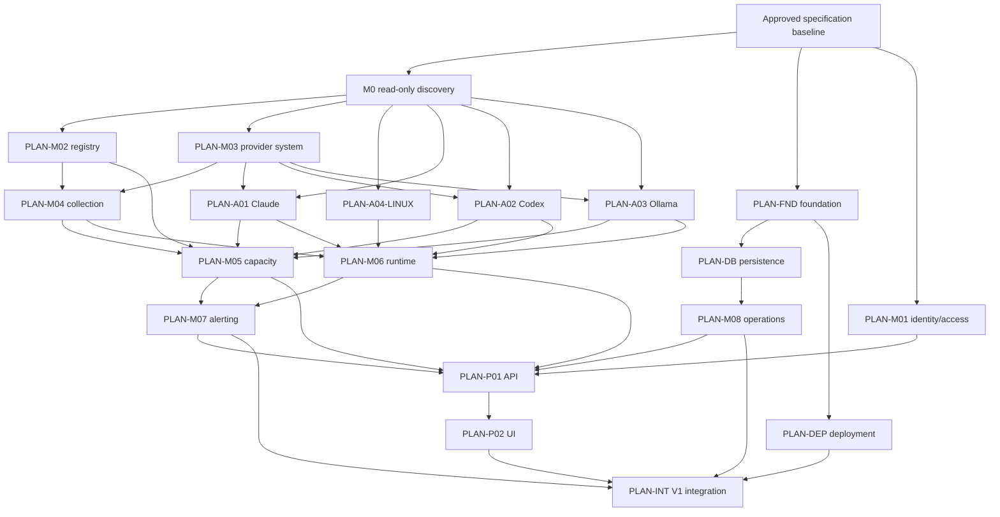

# AgentMonitor V1 planning program

- Status: Synchronized Draft corpus; owner approval and implementation authority pending
- Program version: 0.2.0
- Planning authority: product requirements, V1 acceptance criteria, accepted ADRs, architecture, SDLC, and sub-agent runbook
- Integration steward: root agent; final approver: Pavlo Sidelov
- Created: 2026-09-18
- Production implementation authorization: not granted by this document

## 1. Planning decision

AgentMonitor uses gated, evidence-first planning. The repository now contains
20 synchronized Draft planning artifacts: M0 discovery, foundation, M01–M08,
A01–A03, Linux and macOS platform adapters, FastAPI, React UI, SQLite,
deployment, and integration/release. Their exact paths and statuses are in the
[module planning registry](../README.md); their per-plan producer/consumer sets
are in [contract adoption](../contract-adoption.toml); and their collision-safe
exhaustive nonshared code/test/documentation write sets and shared writers are in
[parallel ownership](../parallel-ownership.toml).

This synchronized Draft is the implementation-planning deliverable, not
implementation authority. Provider/platform facts that require M0 remain
`evidence_blocked`; each plan remains Draft until its own Definition of Ready,
dependencies, contract approvals, real-system prerequisites, and owner approval
are satisfied.

## 2. Program outcomes

Before production implementation begins, this program must produce:

- an owner-reviewed M0 capability/evidence package;
- one approved plan per module, provider adapter, platform adapter, API/UI boundary, persistence/deployment concern, and V1 integration;
- a synchronized contract register with one producer and known consumers per contract;
- individual requirement and acceptance mappings inside module plans;
- a shared-file, migration, generated-artifact, and implementation-wave ownership map;
- a real-system test and live-verification matrix;
- dependency admission records for every selected tool/package;
- implementation increments whose expected Red tests and exit evidence are known;
- explicit Blocked/Not Run items and owner-interaction checkpoints.

## 3. Non-goals

Planning does not:

- initialize Git, create GitLab resources, choose/pin/install dependencies, or create `.env`;
- inspect live accounts/provider files/process content or run provider commands;
- approve undocumented/private provider mechanisms;
- implement schemas, migrations, services, collectors, UI, or tests;
- authorize profile mutation, reauthentication, agent control, routing, or remote exposure;
- treat examples, prospective commands, or draft schemas as working behavior.

## 4. Planning dependency graph

An arrow means the downstream plan needs at least an approved contract proposal from the upstream plan. It does not require the entire upstream implementation to finish before planning can begin.

## 5. Planning waves and synchronization gates

P0–P4 record how the complete Draft corpus was decomposed and synchronized.
They are not a current drafting backlog. Unresolved external facts remain
explicit approval blockers inside the finished module plans.

### P0 — Evidence and stable foundation drafts

Independent artifacts:

- M0 execution plan;
- foundation plan;
- M01 identity/access plan;
- V1 planning program and contract register.

Gate `CS-0 — Draft integrity` verifies scope, IDs, no invented external behavior, no dependency approval claims, and no implementation changes.

### P1 — Provider and identity-bearing boundaries

After owner-reviewed M0 evidence:

- M02 Registry;
- M03 Provider system;
- A01 Claude, A02 Codex, A03 Ollama;
- A04 Linux platform adapter;
- DB persistence adapter draft.

Gate `CS-1 — Discovery-to-contract` decides each provider capability as Supported, Experimental, Deferred, or Unsupported; freezes identity evidence rules, safe source allowlists, normalized common primitives, provider protocol draft, and platform process identity.

### P2 — Observation domains and collection

- M04 Collection control;
- M05 Capacity;
- M06 Runtime observation;
- revised provider/platform plans against domain ports.

Gate `CS-2 — Observation contracts` resolves account/resource references, observation/provenance schemas, collection outcomes/events, process/session correlation, table ownership, idempotency, and failure isolation.

### P3 — Product behavior and operational boundary

- M07 Alerting;
- M08 Operations;
- P01 FastAPI boundary;
- DEP native Linux deployment.

Gate `CS-3 — Application/API contracts` freezes alert/event/query semantics, health/diagnostics/backup contracts, authentication/authorization integration, `/api/v1` schemas, configuration ownership, and native-service responsibilities.

### P4 — UI and V1 integration

- P02 React mission-control UI;
- INT V1 integration/release plan;
- macOS planning status review.

Gate `CS-4 — Implementation readiness` verifies every plan's Definition of Ready, generated-client direction, complete acceptance allocation, implementation-wave ownership, migration ordering, live-test schedule, dependency admission status, and owner approval.

## 6. Contract synchronization method

At each `CS-*` gate, the integration steward builds a producer/consumer review table from the contract register. For every changed proposal:

1. identify the producing plan and all consumers;
2. compare names, semantics, null/unknown behavior, units, time, provenance, errors, authorization, idempotency, and compatibility;
3. identify data/table/configuration/generated-artifact ownership;
4. resolve duplicated concepts and circular dependencies;
5. record accepted decisions in the contract register and affected plans;
6. create an ADR for consequential/breaking decisions;
7. increment the draft/contract version and record reviewer approval;
8. keep unresolved items Open and prevent downstream approval.

No plan resolves a contract gap through direct imports, direct table reads, duplicate DTOs, provider-specific core fields, or UI-side reinterpretation.

## 7. Implementation program after planning approval

Implementation remains unauthorized until the exact affected plans and
contracts are approved and the W0/start-sync gate passes. The intended delivery
sequence below defines bounded implementation waves; it does not authorize one.

### I0 — Reproducible engineering foundation

Repository/tooling, dependency lock/admission, module boundary enforcement, typed configuration, real SQLite migration harness, real running FastAPI/OpenAPI generation, minimal built React client, CI gates, and native development entry points. The browser displays only truthful onboarding/system status.

### I1 — Local authenticated shell

M01 through real SQLite, real HTTP, and built-browser login/session/API-token paths; loopback/host/origin/CSRF enforcement; operations health skeleton. No provider telemetry.

### I2 — Claude real vertical slice

Registry, provider protocol, collection, capacity/runtime minimum, Claude adapter, Linux adapter, API, generated client, and dashboard for one real Claude account. Every layer follows its own approved plan; cross-module work uses frozen contracts.

### I3 — Claude fleet and dashboard alerts

Six intended accounts, hierarchy/correlation, history/forecast, reauth, alert lifecycle, diagnostics, failure isolation, and dashboard validation.

### I4 — Codex vertical slice

Four intended accounts and 5–6 concurrent processes using verified sources/profile isolation.

### I5 — Ollama vertical slice

Two intended identities and 2–4 concurrent agents, with local/cloud capabilities represented honestly.

### I6 — API budget vertical slices

Anthropic, OpenAI, and supported Ollama API budget/cost/usage resources with exact arithmetic and real authoritative reconciliation.

### I7 — Retention, recovery, hardening, and V1 release

365-day retention, exports, rotating verified backups, restore, accessibility/responsiveness, performance to 100 accounts/200 processes, security/privacy/license review, Linux service lifecycle, compatibility, final live matrix, and release gate.

No implementation wave may absorb later scope merely because adjacent code is being changed.

## 8. Implementation ownership rules

- One agent owns one primary plan/module per assignment.
- A task packet grants exact directories and generated/migration ownership.
- Only the integration steward allocates migration revision order and shared generated-file changes.
- Contract source is edited by its producing module; consumers regenerate or adapt only after approval.
- Provider adapters never share internal implementation files.
- The API boundary and UI cannot define domain meaning.
- The first agent encountering missing external evidence stops and returns to M0/discovery status.
- Parallel implementation is allowed only after start-sync confirms no shared file, contract, migration chain, generated output, or live account scenario collision.

## 9. Test planning gates

Every module plan must allocate stable test IDs and specify meaningful expected Red behavior.

| Gate | Required real boundary | Cannot be substituted by |
|---|---|---|
| T1 | Pure deterministic policy/value behavior | I/O, patched clock/environment, duplicate implementation |
| T2 | SQLite file plus real migrations/repositories | In-memory DB or fake repository |
| T3 | Running FastAPI server over loopback HTTP | Direct route calls or simulated transport |
| T4 | Built frontend in real supported browser | DOM-only environment or seeded telemetry |
| T5 | Actual Linux/macOS process/filesystem/service | Fabricated process tree or platform emulator |
| T6 | Real owner-controlled provider/account | Mock, replay, fixture, demo account, invented values |
| T7 | Native lifecycle/backup/restore | Written-only procedure |

The integration plan will treat Passed, Failed, Blocked, and Not Run separately. A hosted CI success covers only the boundaries actually executed there.

## 10. Live-owner coordination points

Owner presence is expected for:

- M0 provider dashboard/CLI comparisons and any approved metadata-field inspection;
- every interactive login, email code, MFA, device flow, or identity confirmation;
- isolated managed-profile experiments after a separate state-change approval;
- authoritative quota/budget reconciliation;
- representative live process/subagent hierarchy confirmation;
- naturally occurring exhaustion/auth/rate-limit/recovery evidence;
- native service installation/upgrade/restore exercises with material local effects.

Each session starts with a reviewed scenario and ends with sanitized evidence, side-effect confirmation, and explicit result. Secrets remain owner-controlled.

## 11. Dependency and tool-selection gate

Plans may name candidate tools, but no package/version is approved or installed until an admission record verifies canonical identity, current license, transitive licenses, maintenance/security/provenance, platforms, native components, telemetry/network behavior, exact purpose, alternatives, pinning, removal, SBOM, and notices obligations.

Foundation planning owns the candidate matrix and selection process. Module-specific packages remain adapter/module-local where possible.

## 12. Planning evidence and status

Planning artifacts use these statuses:

- `Draft`: independently prepared, not synchronized;
- `Contract review`: structurally reviewed, shared decisions unresolved or under review;
- `Approved`: requirements, contracts, tests, risks, dependencies, owner interactions, and paths are stable enough to implement;
- `Blocked`: required evidence/authority is unavailable and prevents meaningful planning;
- `Superseded`: retained historical plan replaced by a linked version.

Planning does not use Passed for behavior that has not been implemented/executed.

## 13. Program risks and controls

| Risk | Control | Gate |
|---|---|---|
| Premature schema based on guessed provider data | M0 before M02–M06/A01–A04 approval | CS-1 |
| Foundation abstractions encode provider assumptions | provider-free technical primitives only | CS-0/CS-1 |
| IAM and API duplicate security responsibilities | explicit M01/P01 trust-boundary contract | CS-3 |
| Shared SQLite creates cross-module coupling | table/migration ownership and repository ports | CS-2/CS-4 |
| Parallel agents overwrite shared files | path ownership and start/completion sync | every wave |
| Tests pass without claimed boundary | real-boundary inventory and evidence template | every increment |
| Dependency selection becomes implicit | Candidate/Pending until admission record | CS-4 |
| Live testing disrupts active work | owner schedule, side-effect budget, stop rules | M0/T5/T6 |
| Plans become stale after evidence changes | version/status/supersession and provider-version trigger | every gate |

## 14. Approval checkpoints

The owner is asked to approve separately:

1. the exact synchronized 20-plan Draft baseline and contract/ownership controls;
2. each M0 live/read-only session and any later state-changing isolated-profile experiment;
3. contract synchronization results and module plans;
4. dependency/version admissions;
5. implementation start for the first approved wave;
6. destructive migrations, external resources, GitLab operations, native install, and release when applicable.

Approval of this program does not implicitly approve any later item.

## 15. Current program state

- Specification baseline: available.
- Git repository: not initialized as of planning preflight.
- Production code/tests/manifests/configuration: absent.
- M0 real evidence: Not Run.
- Detailed module plans: all 20 synchronized Draft artifacts are present and
  mapped to requirements, scenarios, contracts, increments, tests, live
  boundaries, risks, handoffs, and approval gates.
- Contract versions: proposed Draft 1.0.0; exact adoption is machine-bound;
  approval remains pending.
- Parallel allocation: exact non-overlapping, plan-hash-bound write sets and shared
  writers are recorded; concrete agent/resource assignment is required at each
  start-sync.
- Implementation readiness: not reached; provider/platform evidence,
  dependency admission, individual plan approval, and owner authorization
  remain outstanding.
